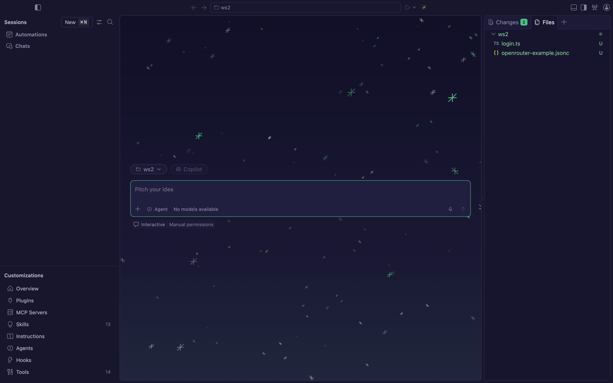
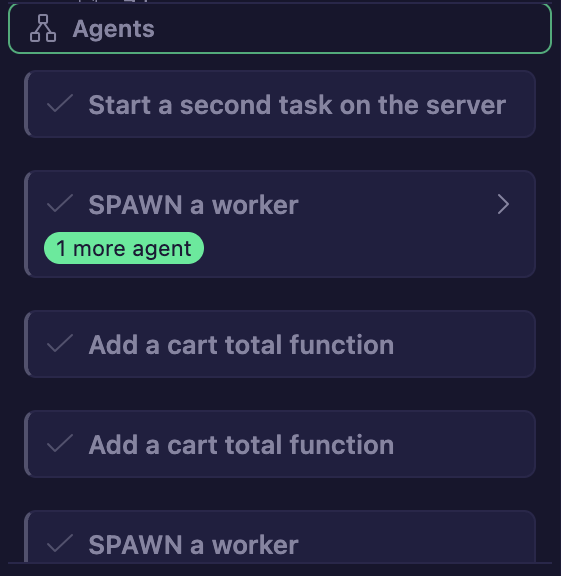
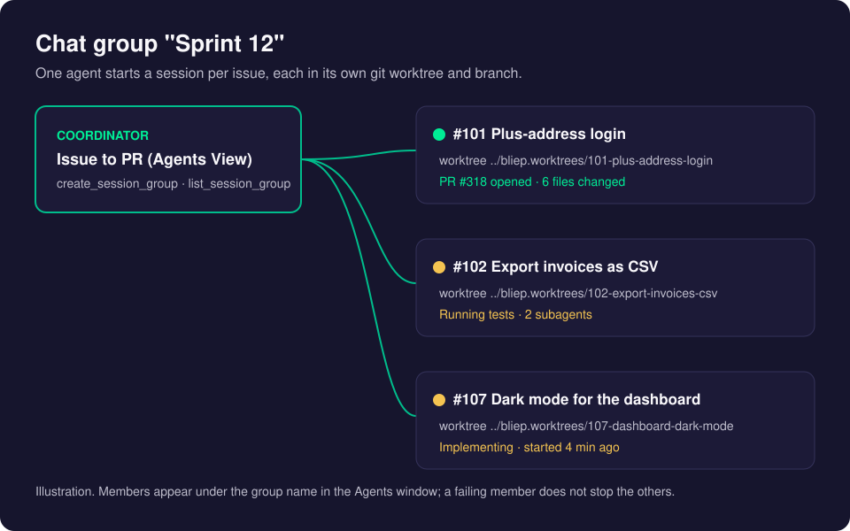
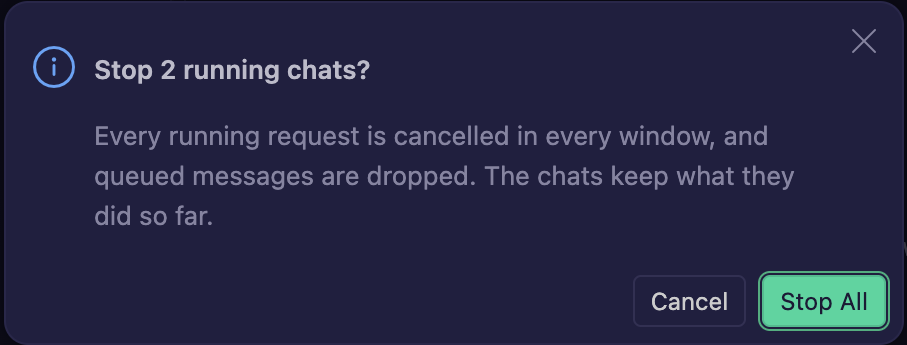

# The Agents Window

The Agents window is a separate CreaEditor window made for working with AI agents. Each **session** is an agent working on one task, and several sessions can run side by side. It is also where you see what your agents and subagents are doing, what they cost, and where you reach your [CreaEditor Servers](creaeditor-server.md).

## How it works

- **On the left**, the **Sessions** list, with the buttons New, Filter and Find at the top, and four CreaEditor buttons: **Toggle Agents Tree**, **Show AI Costs** (credit card), **Show Subscription Usage** (pulse) and **Stop All Chats** (stop). Below the list is the **Agents** section.
- **In the middle**, the chat and its input box. Above the input box you pick the folder (or a server's repository); below it the agent and the model.
- **On the right**, the **Changes** and **Files** of the session.

The agents (Claude, Codex, Copilot CLI) run in a separate background process called the **agent host**. That is why a chat keeps running when you close its tab, and why the same chats can show on your phone ([Remote Access](remote-access.md)) or on a server.

## Using it

### Open it and start a session

1. Press **Cmd+Shift+A** in any CreaEditor window, or run **Open Agents Window**, or click **Try out the new Agents window** at the bottom of the Welcome page.
2. Click the folder button above the input box and pick your project folder.
3. Optional: check **New Worktree** to let the session work in its own copy of the repository (a git worktree) on its own branch, so your own files stay untouched.
4. Type what you want done and press Enter.

### The Agents tree

The **Agents** section is a live map of your agents. Every chat or session is a card, with lines to the subagents it started, and on to their own subagents.

- Each card shows the task, status, model and how long it ran, and updates live. Its colored edge shows the status: running, waiting for confirmation, done or failed.
- Click a card to jump to that chat. The arrow on a card folds its subagents. The arrow keys and Enter work too.
- Running agents are always at the top. Finished, cancelled, closed and archived agents stay in a quieter grey, with their subagents folded away. Only the 20 most recent closed or archived ones are kept.
- Subagents show there while they run, also for sessions you have not opened.

To show or hide it, click **Agents** below the Sessions list, or the tree button at the top of the list. Drag the line above it to make it taller or shorter. In the editor window, run **Show Agents Tree** to open the same view next to the chat.

### Subagents that start subagents

When an agent splits up its work, its subagents can start their own subagents. They appear as cards inside the parent's card in the chat, and in the Agents tree. A subagent that fails shows why on its card; the parent keeps going. The depth is counted per chain, so parallel subagents do not use up each other's budget.

### Chat groups: several pull requests at once

An agent in the Agents window can start other sessions, each in its **own git worktree on its own branch**, and follow them up. CreaEditor ships a built-in agent for this, the **Director**.

1. Open the Agents window and pick your repository in the folder button.
2. Click **Agent** below the input box and choose **Director**. The New Worktree checkbox disappears: the Director itself never changes code, so it works in your folder.
3. Describe the work, for example "make PRs for issues #101, #102 and #107 on develop", and press Enter.
4. The Director reads the issues, checks that they do not overlap and proposes one session per issue. When it cannot tell whether they are GitHub or Jira issues, it asks first. Confirm the list once.
5. The new sessions appear in the Sessions list under one group name. Each runs the **Issue to PR** agent on its own branch: it implements its issue, has the **Code Reviewer** agent review it, and opens its own pull request. A failing session does not stop the others.
6. The Director follows them up and ends with a table of branches and PR links.

The Director reads GitHub issues with the GitHub CLI, so install **gh** and run `gh auth login` first. With [Jira](#jira) connected, it reads Jira issues too.

### Issue to PR and Code Reviewer

You do not need the Director for a single issue. CreaEditor ships two more built-in agents, in the same **Agent** picker:

- **Issue to PR** takes one issue to a ready-to-review pull request: it reads the issue, moves it to In Progress (on a GitHub Project board, or the Jira transition), creates a branch, plans, implements, tests, runs the project's own checks, has the Code Reviewer review the changes, fixes real findings (at most two rounds), pushes, opens the pull request and moves the issue to In Review. Ask it, for example, "work on issue #123" or "finish PROJ-45". When your prompt does not say whether it is a GitHub or a Jira issue, it asks. It reads the project's own rules (AGENTS.md, CONTRIBUTING, build files) for the test commands and conventions.
- **Code Reviewer** is a read-only reviewer: it reads a branch's changes against its base and the issue's acceptance criteria, and reports verified findings with file and line. It never edits. Issue to PR runs it as a subagent in its own context; you can also run it yourself, for example "review 101-fix-login against main".

The Director starts every issue session as Issue to PR, so each of them runs its own Code Reviewer, exactly as when you run Issue to PR yourself. To change either agent for a project, copy it into the project's `.github/agents/` and edit the copy.

To make your own director, copy the built-in one into `.github/agents/` and give the file a name ending in `director.agent.md` (for example `sprint-director.agent.md`). Any agent whose `tools` include `agent` can start sessions with the `create_session` and `create_session_group` tools (up to 10 sessions at once).

### Stop All Chats

**Stop All Chats** stops every running chat in every window and drops queued messages. The chats keep what they did so far. When more than one chat runs, it asks first.

Use the stop button at the top of the Sessions list, or run **Stop All Chats** from the Command Palette.

### Jira

Agents can read Jira issues directly, with their description and comments.

1. Run **CreaEditor: Connect Jira...** from the Command Palette.
2. Choose **Sign In with Atlassian**, confirm that CreaEditor may start the Atlassian server, and sign in once in your browser. (Or choose **Use a Service Account API Key** when your Atlassian admin enabled API keys.)
3. Mention a key in a chat, such as "Fix PROJ-123", or ask for "all open bugs in sprint 12".

Agents only see what your Atlassian account can see. It works with Atlassian Cloud sites (`yourcompany.atlassian.net`), not with self-hosted Jira Data Center. Jira keys also count as the issue on the [AI Costs](costs-and-budgets.md) page.

### Request metadata

Extra headers and body fields per key and model, for the gateway's logs, are explained in [Models and Keys](models-and-keys.md#request-metadata).

### Backgrounds and the Creacoon pet

- **Backgrounds:** right-click an empty part of the chat area and choose **Set Background...** (also in the Command Palette). Choose **Starry Night** (the default), **Creacoon Pattern**, **Codicons**, your own **Image...**, or **No Background**. Dark and light themes each remember their own choice.
- **Pet:** run **Chat: Toggle Creacoon Pet** from the Command Palette (or type `/creacoon-pet` in the input box and press Enter, or right-click an empty spot of the chat background, on the new-session screen or in a chat, and check **Pet**). The pixel-art Creacoon acts out what your agents do; every subagent gets its own smaller pet. To turn it off, uncheck **Pet** in that menu, right-click the pet and choose **Hide Pet**, or run the same command again.

## Settings

| Setting | Default | What it does |
| --- | --- | --- |
| `chat.subagents.allowInvocationsFromSubagents` | `true` | Lets subagents start their own subagents. |
| `chat.subagents.maxNestingDepth` | `5` | How many levels deep subagents may go. A subagent started by the main agent has depth 1. At most 10. |
| `chat.agentHost.maxSessionSpawnDepth` | `3` | How deep sessions started by agents may nest. |
| `chat.agentHost.agentOrchestrationLimits` | `on` | `off` removes the depth and breadth limits on sessions started by agents. |
| `chat.agentSessions.preferredDarkBackgroundImage` | `starryNight` | The background for dark themes. |
| `chat.agentSessions.preferredLightBackgroundImage` | `starryNight` | The background for light themes. |

## Good to know

- A session in a new worktree opens its first answer with "Created isolated worktree for branch ...". The worktree is a separate folder; your own folder is not changed.
- High contrast themes show no background. With reduced motion on, the stars do not twinkle and the pattern does not move.

## Related pages

- [Models and Keys](models-and-keys.md)
- [Costs and Budgets](costs-and-budgets.md)
- [Remote Access](remote-access.md)
- [CreaEditor Server](creaeditor-server.md)
