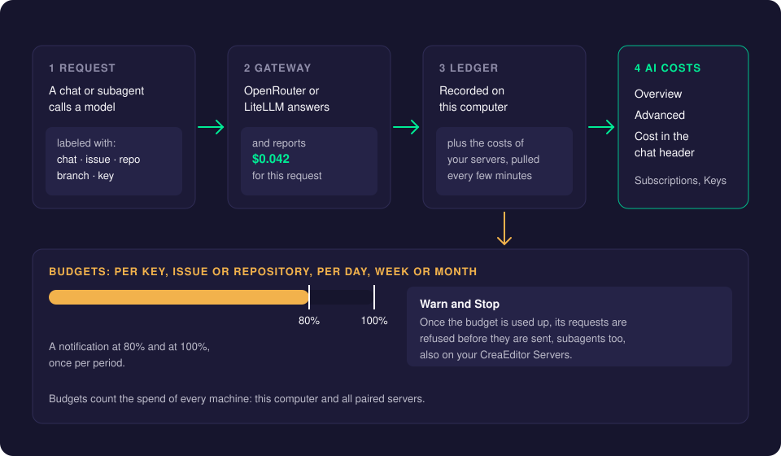
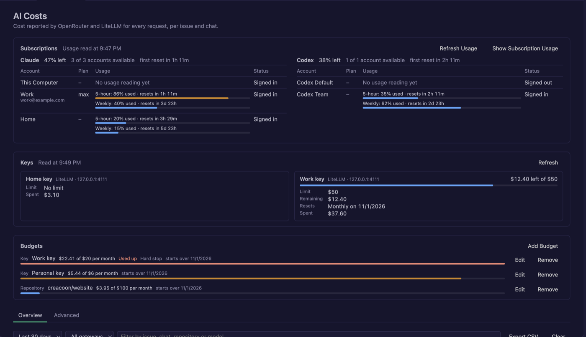
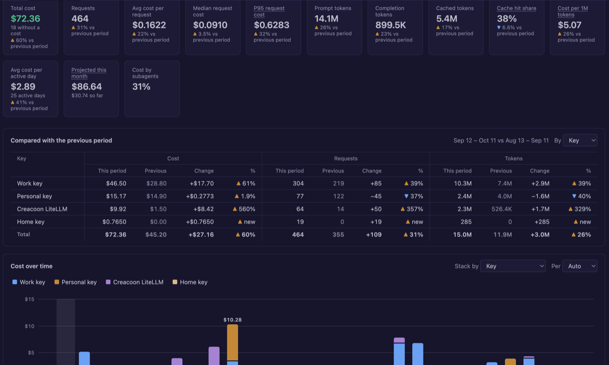
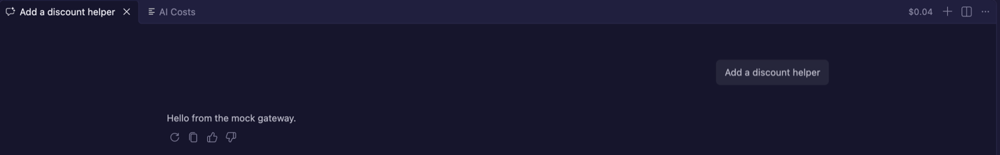
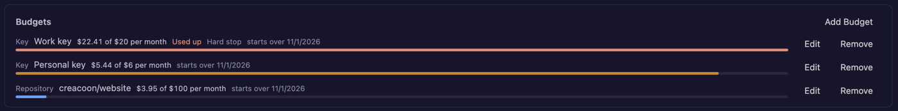

# Costs and Budgets

Every request CreaEditor sends to OpenRouter or LiteLLM is labeled with the chat it belongs to and the issue it works on. The gateway reports what the request cost, and CreaEditor records it. The **AI Costs** page turns that into a clear answer to "what did this issue cost?" and "what did this chat cost?". **Budgets** warn you, or stop the requests, before spending gets out of hand.

## How it works

1. **The request.** Each request carries the chat, the issue, the repository, the branch and the key. Subagents carry their own id and add up to the chat that started them.
2. **The gateway** answers and reports the cost of that request (OpenRouter in the response, LiteLLM in a response header; CreaEditor asks again afterwards when it was missing).
3. **The ledger.** CreaEditor writes every request to a cost file on your Mac. While the Agents window is open, it also pulls the costs of your [CreaEditor Servers](creaeditor-server.md) every few minutes.
4. **AI Costs** shows it all, and **budgets** compare it against the amounts you set.

**How the issue is found**, in this order: an agent sets it with the **Set Chat Issue** tool; a GitHub or Jira issue (URL, `owner/repo#123`, `PROJ-123` or `#123`) in the first prompt; or the branch name (`PROJ-123-fix-login`, `123-fix-login`, `issue/123`). Words like `UTF-8` or `GPT-5` never count as Jira keys.

Because the same labels go to the gateway, the breakdown is also visible in the OpenRouter activity log and in LiteLLM's spend tracking, for the whole team.

## Using it

### Open AI Costs

Use any of these:

- In the Agents window, click the credit card button at the top of the Sessions list. The page opens full screen over the chat.
- In the model picker, click the credit card button next to **Other Models** (once a key shows its limit).
- In any window, run **Chat: Show AI Costs** from the Command Palette.

### The Overview tab

The **Overview** tab shows the total per issue, and per chat within each issue. Filter by period (last 7, 30 or 90 days, or all time), by gateway or by text, and click **Export CSV** to download everything.

### The Advanced tab

The **Advanced** tab is for digging deeper.

1. **Filter.** Filter on date range, key, model, gateway, repository, branch, issue, chat, cost source, **Machine**, main chats or subagents, missing costs, cost per request, or free text.
2. **Stack filters by clicking.** Each click on a bar, a legend entry or a table row adds a filter chip. Chips of the same kind match any of them (model A *or* model B); chips of different kinds all apply (model A *and* issue 42). Click **Clear** to start over.
3. **Read the numbers.** Cards show the total, the median and P95 (95% of the requests cost this much or less) request cost, tokens, cache hit share, average cost per active day and a projection for this month.
4. **Compare periods.** Pick **Compare** to put the period next to the one before it of the same length, or choose **This month vs last month**. You see cost, requests and tokens per key or model with the change, and every card shows its change too.
5. **Look at the charts.** Cost over time stacked by key, model or another dimension, a breakdown, tokens over time and a pivot table.
6. **Export.** **Export CSV** or **Export JSON** downloads the requests that match the filters.

The tab and its filters are remembered the next time you open the page.

**Machine** is "This computer" for requests made on your Mac, or the name of a CreaEditor Server for requests the server made itself, for example for a [delegated chat](delegate-to-server.md). Every request in the table shows its machine.

### Cost per chat in the chat header

As soon as a chat has a cost, its header shows it, subagents included: in the chat view title, the chat editor title, and the session title bar in the Agents window. Point at it to see requests and tokens; click it to open AI Costs filtered to that chat.

### Subscriptions and Keys sections

- **Subscriptions** at the top shows your Claude and Codex pools (share left, accounts available) and per account its email, plan, usage windows and status. It refreshes every 30 seconds; **Refresh Usage** asks for new readings and **Show Subscription Usage** opens the usage page. See [Subscription Accounts](subscription-accounts.md).
- **Keys** shows per OpenRouter or LiteLLM key its limit, what is left (with a bar), when the limit resets and what the gateway says it spent today, this week and this month (OpenRouter) or since the last budget reset (LiteLLM). When a key cannot be read, it says why.

### Add a budget

1. Click **Add Budget** on the AI Costs page, or run **Chat: Add AI Budget**.
2. Choose what the budget is for: a **Key**, an **Issue** (such as `acme/web#42` or `PROJ-7`) or a **Repository** (such as `acme/web`).
3. Pick the key, issue or repository from the list, or type it.
4. Enter the amount in US dollars.
5. Choose how often it starts over: **Per Day**, **Per Week** (from Monday) or **Per Month**.
6. Choose what happens when it is used up: **Warn Only** (a notification at 80% and 100%) or **Warn and Stop** (also refuse requests once the budget is used up).

When a budget reaches 80% and 100%, a notification says so, once per period, with **Open AI Costs** and **Edit Budget**. With **Warn and Stop**, requests of that key, issue or repository, subagents included, are refused before they are sent, with a message such as "The monthly budget of $50 for the Personal key is used up. Raise it on the AI Costs page."

## Settings

| Setting | Default | What it does |
| --- | --- | --- |
| `creaeditor.aiCosts.budgets` | `[]` | Your budgets. Each has `scope` (`key`, `issue` or `repo`), `value`, `amount` (US dollars), `period` (`day`, `week` or `month`, default `month`), `warnAt` (default `[80, 100]`) and `hardStop` (default `false`). |

Budgets are a normal setting, so they sync with Settings Sync and you can edit them as JSON (for example to change `warnAt`).

## Good to know

- **Budgets count every machine.** The spend of this computer and of all paired CreaEditor Servers adds up. Budgets with a hard stop are also sent to every server, with what was spent elsewhere this period, so a server refuses requests once the budget is used up too. When a period ends before CreaEditor sends again, the server counts only its own spend until then.
- **Server costs need the Agents window.** CreaEditor pulls server costs while the Agents window is open (it may stay in the background). Open it once after starting CreaEditor.
- **The data stays on your Mac.** Only the gateways see your requests, as they always do.
- **Only gateway requests have a cost here.** Claude and Codex *subscriptions* are not billed per request; see their usage on the [Subscription Usage](subscription-accounts.md) page instead.

## Troubleshooting

- **A chat shows no cost.** Only OpenRouter and LiteLLM requests are tracked. A request whose cost the gateway did not report yet shows up under **Only requests without a cost** on the Advanced tab; it fills in when the gateway reports it.
- **A request is "Not linked to an issue".** Mention the issue in the first prompt, use a branch name with the issue number, or ask the agent to set it with the Set Chat Issue tool.
- **Server costs are missing.** Open the Agents window and make sure the server shows as Online in **CreaEditor Servers**.

## Related pages

- [Models and Keys](models-and-keys.md)
- [Subscription Accounts](subscription-accounts.md)
- [CreaEditor Server](creaeditor-server.md)
