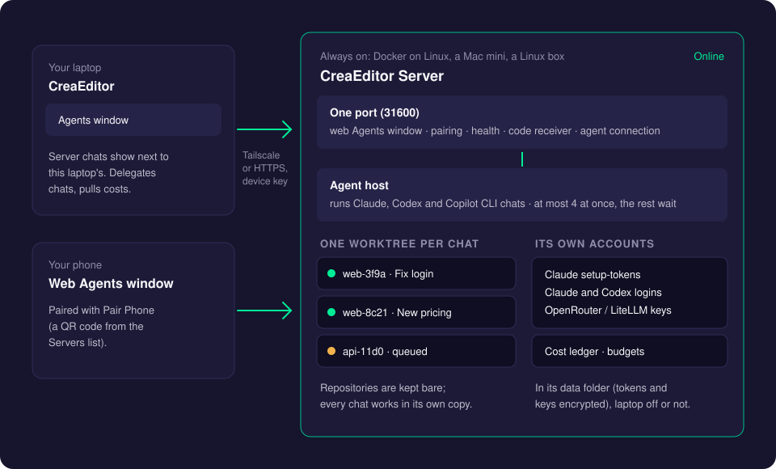
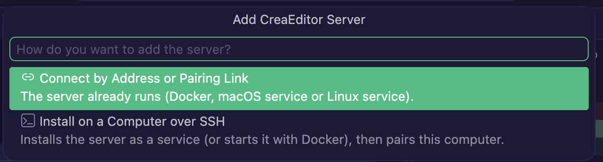
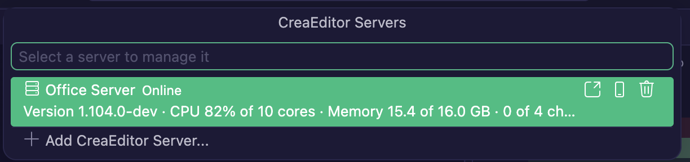
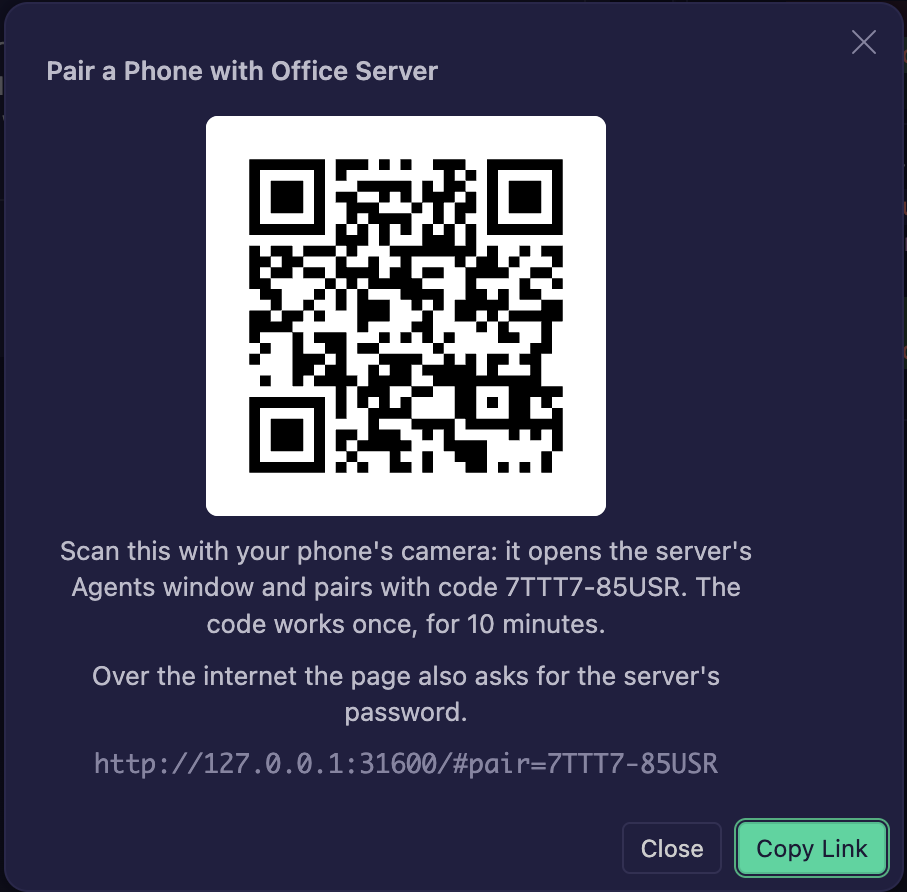
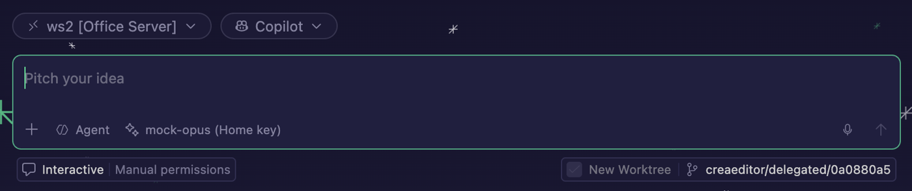
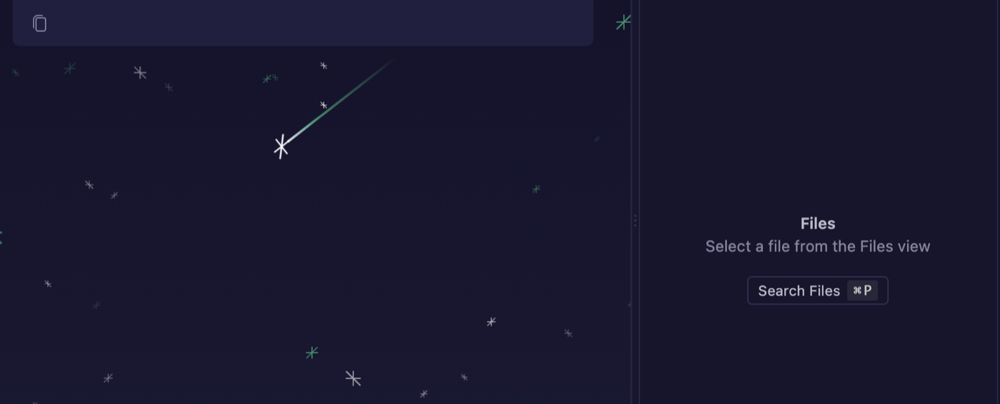
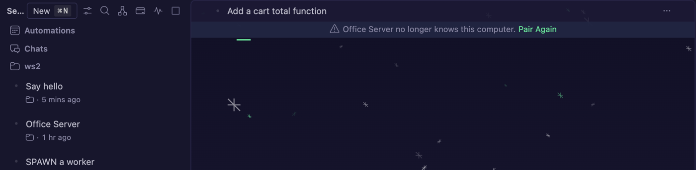

# CreaEditor Server

A CreaEditor Server is a CreaEditor without a window that runs the agents (Claude, Codex, Copilot CLI) on a computer that is always on: a Linux server with Docker, a Mac mini in the office, or a Linux box. You use it from CreaEditor on your laptop, where its chats show in the Agents window next to the laptop's, and from your phone. The server keeps its own chats, accounts and worktrees, so it keeps working while your laptop sleeps.

Usually one person on the team installs the server once; everyone else only adds and pairs it.

## How it works



- **One port** (31600 by default) serves everything: the web Agents window for phones and browsers, pairing, a health check, the code receiver for [delegated chats](delegate-to-server.md), and the connection your laptop uses for its chats.
- **The agent host** runs the chats. It runs at most 4 chats at the same time (you can change that); more chats wait in a queue and start by themselves.
- **Worktrees:** the server keeps each repository once, as a **bare repository** (a git repository without a working folder, only its history and branches). Every chat works in its own **git worktree**: its own folder and branch made from that repository. So chats never get in each other's way.
- **Its own accounts:** the server has its own Claude and Codex logins and keys, kept in its data folder (tokens and keys encrypted). They are sent there from your laptop, encrypted, when you delegate a chat, or you sign in once on the server.
- **Pairing:** like [Remote Access](remote-access.md), every laptop and phone pairs once with a one-time code and then has its own device key.

## Installing a server

You need one of these: a Linux machine with Docker, a Mac with Apple silicon, or a Linux machine without Docker. Tailscale on the server and on your devices is recommended (the server then listens on its Tailscale address only).

### With Docker (Linux)

From a copy of the CreaEditor repository on the server:

```sh
docker build -f build/creaeditor-server/Dockerfile --build-arg BUILD_SOURCEVERSION=$(git rev-parse HEAD) -t creaeditor-server .
cd build/creaeditor-server
docker compose up -d                                              # on 127.0.0.1:31600 of the Docker host
docker compose exec creaeditor-server creaeditor-server pair      # prints a pairing code and link
docker compose exec creaeditor-server creaeditor-server status
```

Then choose how your devices reach it:

- **Tailscale (recommended):** put `TS_AUTHKEY=tskey-auth-…` (an auth key from the Tailscale admin console) in a `.env` file next to `docker-compose.yml` and run `docker compose --profile tailscale up -d`. The server joins your tailnet as `creaeditor-server` and is reachable at `https://creaeditor-server.<tailnet>.ts.net`. Set `CREAEDITOR_SERVER_PUBLIC_URL` to that address so pairing links use it.
- **Your own domain with HTTPS:** put `CREAEDITOR_PUBLIC_DOMAIN=agents.example.com` in `.env` (a DNS record must point at the machine, with ports 80 and 443 open) and run `docker compose --profile public up -d`. Caddy gets a certificate automatically.
- **Public mode** (a domain, or Tailscale Funnel): pairing then needs a password as well as the code. Set it once with `docker compose exec creaeditor-server creaeditor-server password`.

The image runs as a normal (non-root) user, includes `git`, `gh` and `ssh`, and keeps everything in the `creaeditor-data` volume. Building it from source needs about 8 GB of memory.

### As a macOS service (Apple silicon)

1. Copy `creaeditor-server-darwin-arm64.tar.gz` to the Mac and extract it.
2. Run `creaeditor-server/install.sh`.

It installs into `~/Applications/CreaEditor Server`, starts at login and restarts when it stops. It listens on the Mac's Tailscale address when Tailscale runs, otherwise on 127.0.0.1 (`--host` and `--port` change that). Logs are in `~/Library/Logs/CreaEditor Server/server.log`. Remove it with `install/macos/uninstall.sh` (`--purge` also deletes its data).

### As a Linux service (without Docker)

1. Extract the Linux tarball and run `creaeditor-server/install.sh`.
2. Install `git` (and `gh` for pull requests) on the machine.

As root it installs a system service that runs as the user `creaeditor`; as a normal user it installs a user service (run `loginctl enable-linger $USER` once so it keeps running after you log out). Logs: `journalctl -u creaeditor-server` (add `--user` for a user service). Remove it with `install/linux/uninstall.sh`.

### Over SSH, from CreaEditor

You can also install it on a computer you reach over SSH, without logging in there yourself:

1. In the Agents window, run **Add CreaEditor Server...** and choose **Install on a Computer over SSH**.
2. Pick a host from your SSH config, or type `user@host`.
3. Choose how to install: **Install as a Service from a Server Tarball** (copies a tarball from this computer), **from a Download URL** (that computer downloads it), or **Run with Docker** (runs an image you built there).
4. Choose how this computer reaches it: **Tailscale** (recommended), **Every Network of That Computer** (plain HTTP, trusted networks only) or **Only That Computer** (for a domain or Funnel you set up there; you then enter its address).

CreaEditor reads the pairing code the installer prints and pairs this computer right away.

## Using it

### Add the server in CreaEditor

1. Ask whoever runs the server for a pairing link (from `creaeditor-server pair`, or **Pair Phone** on a device that is already paired). It looks like `http://100.x.y.z:31600/#pair=ABCDE-12345`.
2. In the Agents window, run **Add CreaEditor Server...** from the Command Palette (also under **Manage** in the folder picker, or the button on the CreaEditor Features page).
3. Choose **Connect by Address or Pairing Link** and paste the link. Just the address works too; CreaEditor then asks for the code. A bare `100.x.y.z` means port 31600.
4. Give the server a name, such as "Office Server". A public server also asks for its password.



CreaEditor keeps the device key in its secret storage (never in settings) and connects. The server's chats now show in the Agents window, grouped under the server.

### The Servers list

Run **CreaEditor Servers** (Command Palette, or **Manage** in the folder picker) to see every server:



- **Online** or **Offline** (with when it was last seen), its version, and the CPU and memory of the server machine.
- Running and queued chats, such as "3 of 4 chats running · 2 queued", and whether it is public.

Click a server for its actions: **Open in Browser**, **Pair Phone**, **Sign In to an Account on This Server...**, **Clean Up Server...** (see [When the server removes a worktree](#when-the-server-removes-a-worktree)), **Check Now** and **Remove** (signs this computer out of the server and forgets its key; the server keeps running).

### Pair your phone with the server

1. In **CreaEditor Servers**, click the phone button of the server (or the server, then **Pair Phone**).
2. Scan the QR code with your phone. It holds a fresh one-time pairing code, so the phone pairs as soon as it opens the page.



### Accounts on the server

The server needs its own Claude or Codex login to run chats. There are two ways to give it one:

- **Sent from your laptop.** When you [delegate a chat](delegate-to-server.md), the Claude setup-token accounts it needs (and, for Copilot CLI chats, the OpenRouter or LiteLLM key) go along, encrypted so only the server's agent host can read them. Your personal agents, skills and instructions (`~/.claude`, `~/.copilot`, `~/.codex/AGENTS.md`) go along too, for that chat only; see [What your server uses from your laptop](delegate-to-server.md#what-your-server-uses-from-your-laptop).
- **Log in once on the server.** Browser-login Claude accounts and Codex logins cannot be moved. In **CreaEditor Servers**, click the server, then **Sign In to an Account on This Server...**:
  - **Claude: Sign In with a Browser**: the server starts the Claude sign-in; CreaEditor opens the sign-in page on your laptop, and you paste back the code the page shows.
  - **Claude: Paste a Setup-Token**: paste a token from `claude setup-token`. The server keeps it encrypted.
  - **Codex: Sign In with a Device Code**: CreaEditor copies the code and opens the page where you enter it.

### Start a new chat on the server

To start a chat on the server with code from your laptop, type its first message in a new chat on this computer and click **Start on Server...** below the input: see [Start a new chat on a server](delegate-to-server.md#start-a-new-chat-on-a-server).

You can also start a chat on the server directly, in a repository it has from an earlier delegated chat:

1. In the Agents window, click the folder button above the input box.
2. Pick the repository under your server. It is shown as `<repository> [<server>]`, for example "ws2 [Office Server]".
3. Below the input box, **New Worktree** is checked and cannot be turned off: the server keeps repositories without a working folder, so every new chat gets its own worktree.
4. The branch picker next to it starts on the newest branch of the repository (usually the branch of your latest delegated chat). Pick another if you like.
5. Type your request and press Enter.



The first answer starts with "Created isolated worktree for branch ...", and the chat works in that folder from then on.



### When the server no longer knows this computer

If the server was reset, or this computer was signed out on it, the server refuses this computer's key. CreaEditor then stops reconnecting and says so:

- The Servers list shows the server as **Needs pairing again**.
- A notification says "*Office Server* no longer knows this computer (it was signed out, or its data was reset). Pair again to use its chats."
- The banner on the server's chats says "*Office Server* no longer knows this computer." with **Pair Again**.



To fix it:

1. Click **Pair Again** (on the banner, the notification, or the server in the Servers list).
2. Paste a new pairing link or code from the server: run `creaeditor-server pair` there, or use **Pair Phone** on another paired device.

The server's chats stay open while it needs pairing and reconnect with the new key.

### Several chats at once

The server runs several chats at the same time, each in its own worktree. To keep the machine responsive it runs at most 4 at once (`--max-running-chats`). A chat you send while that many run waits and shows "Queued on *Office Server* (2 ahead)", then starts by itself when another one finishes. Stopping a queued chat takes it out of the queue.

### When the server removes a worktree

Every delegated chat gets its own worktree in the server's data folder (`worktrees/<repository>-<id>`, on the branch `creaeditor/delegated/<id>`). The server removes it, with its branch and record, when you delete the chat on the server, 7 days after the chat was archived (Take Back Here archives it), or 30 days after it was delegated when no chat on the server works in it any more. Except when you delete the chat, it only does so while the worktree's latest work is safe: brought back to your laptop, pushed in a pull request, or never changed. The server checks when it starts and every 4 hours, and logs every removal.

To remove worktrees yourself, click the server and choose **Clean Up Server...**: it lists each worktree with its size, the state of its chat and whether its work was brought back, and warns before removing work that was not. See [Delegate to Server](delegate-to-server.md#when-the-server-removes-a-worktree) for the details.

Worktrees of chats you start on the server itself (under `<repository>.worktrees/`) are removed with their chat.

### Server costs and budgets

OpenRouter and LiteLLM requests the server makes itself are recorded on the server. While the Agents window is open, CreaEditor pulls them every few minutes, and the [AI Costs](costs-and-budgets.md) page shows them with everything else: the **Advanced** tab has a **Machine** filter (This computer, or the server's name).

Budgets count the spend of all machines. Budgets with **Warn and Stop** are also sent to every server, so the server refuses requests once the budget is used up.

## Settings and options

On your laptop there are no server settings: servers are added with **Add CreaEditor Server...** and their keys are kept in secret storage. The [compaction](subscription-accounts.md#compacting-idle-claude-chats-before-the-prompt-cache-expires) and [notification](notifications.md) settings of your laptop also apply on the server.

On the server, `creaeditor-server` takes these options (each also as an environment variable):

| Option | Environment variable | Default | What it does |
| --- | --- | --- | --- |
| `--host` | `CREAEDITOR_SERVER_HOST` | `127.0.0.1` (`0.0.0.0` in Docker) | The address it listens on. |
| `--port` | `CREAEDITOR_SERVER_PORT` | `31600` | The port. |
| `--data-dir` | `CREAEDITOR_SERVER_DATA_DIR` | `~/.creaeditor-server` (`/data` in Docker) | Where chats, accounts, repositories and worktrees are kept. |
| `--public-url` | `CREAEDITOR_SERVER_PUBLIC_URL` | | The address used in pairing links. |
| `--public` | `CREAEDITOR_SERVER_PUBLIC=1` | off | Public mode: pairing also needs the password. |
| `--max-running-chats` | `CREAEDITOR_SERVER_MAX_RUNNING_CHATS` | `4` | How many chats run at the same time. |
| `--disable-codex` | `CREAEDITOR_SERVER_CODEX=0` | off | Do not offer the Codex agent. |

Server commands: `creaeditor-server pair` (a new pairing code, link and QR code), `password` (set or remove the public-mode password), `status` (agent host state, devices, CPU and memory), `version` and `help`.

## Good to know

- **Backups:** stop the server and copy its whole data folder. Keep `secrets/master.key` together with `secrets/secrets.json`: one is useless without the other, so store the backup privately.
- **Updating:** Docker: rebuild the image and run `docker compose up -d` again (the data volume stays). macOS and Linux: run the new tarball's `install.sh`; it keeps the data and paired devices. Paired laptops and phones reconnect by themselves.
- **First start:** with no device paired yet, the server prints a pairing code to its log and writes it to `pairing.txt` in its data folder.
- The `pair`, `password` and `status` commands only work for the server's own user (or root).

## Troubleshooting

- **The server shows Offline.** Check that it runs (`creaeditor-server status`, `docker compose ps`, or the service logs) and that Tailscale is on, on both sides. Click **Check Now**.
- **Needs pairing again.** See [When the server no longer knows this computer](#when-the-server-no-longer-knows-this-computer).
- **A chat on the server says it has no account.** Sign in once with **Sign In to an Account on This Server...**, or delegate a chat that runs on a Claude setup-token account.
- **Chats wait in a queue.** The server is at its running chats limit. Wait, stop a chat, or raise `--max-running-chats` if the machine can handle it.
- **The phone shows only the pairing page.** The server was built without the web Agents window. Ask whoever installed it to use the full tarball or Docker image.

## Related pages

- [Delegate to Server](delegate-to-server.md)
- [Remote Access](remote-access.md)
- [Notifications](notifications.md)
- [Costs and Budgets](costs-and-budgets.md)
