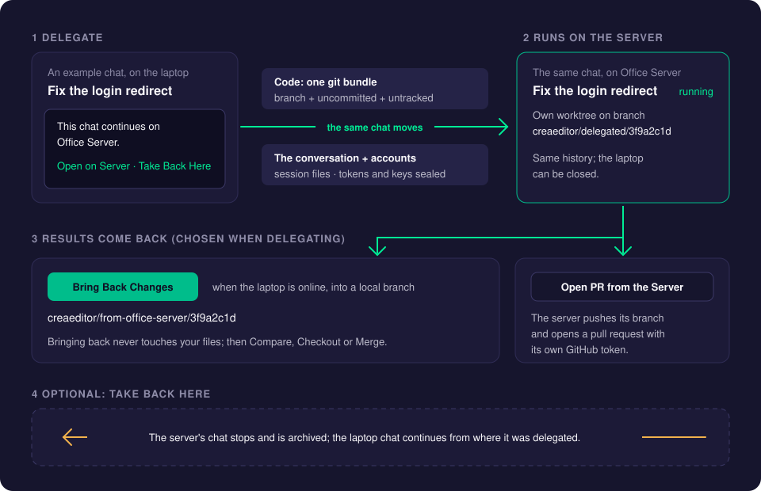
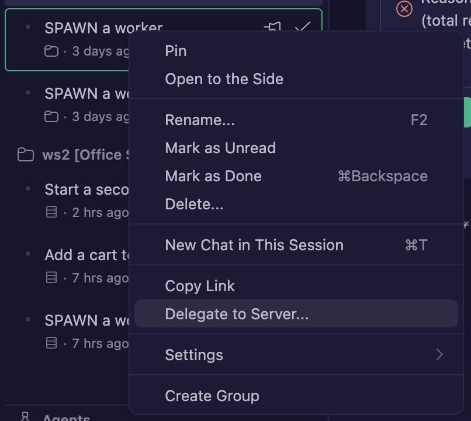
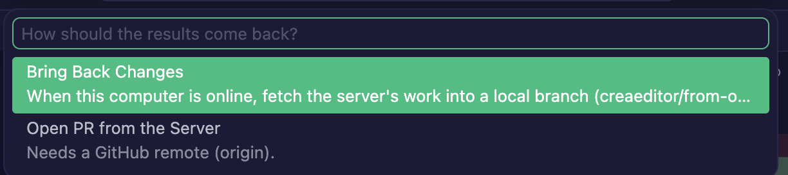
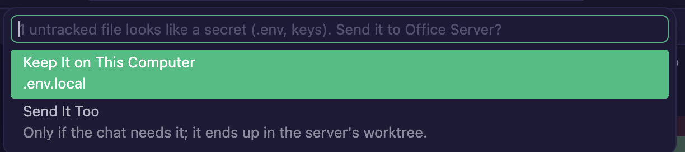
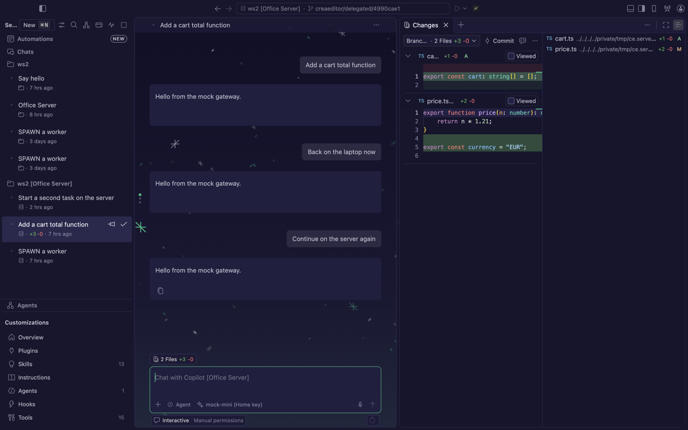
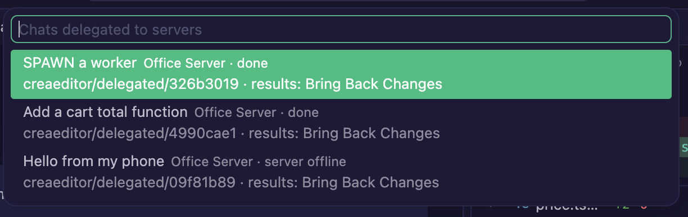
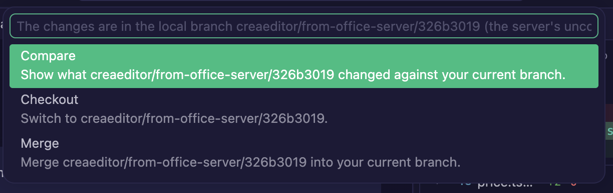
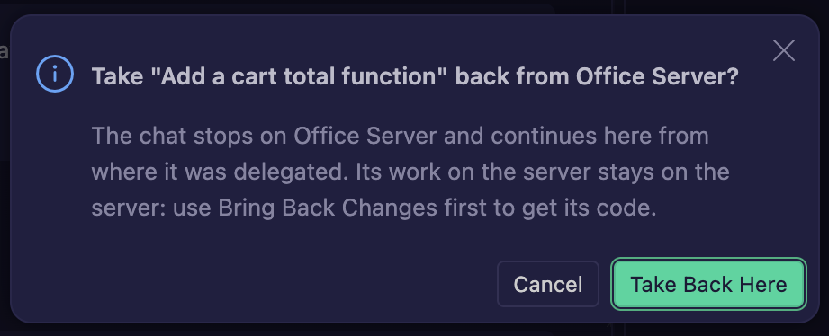

# Delegate to Server

**Delegate to Server** moves a chat from your laptop to your [CreaEditor Server](creaeditor-server.md): its code (uncommitted changes included), its whole conversation and the accounts it needs. The chat then continues on the server, so you can close the laptop and go home. Later you bring the results back as a local branch, or let the server open a pull request.

A chat only runs in one place at a time: while it is delegated, the laptop's copy is locked.

## How it works

What goes to the server:

- **The code**, as one **git bundle** (a single file that holds git commits): the current branch with the history the server does not have yet, plus your uncommitted changes and your untracked files that are not ignored by `.gitignore`. Your own files, index and branches are not touched. The first time, the whole history of the branch goes up; after that only new commits.
- **Files that look like secrets** (`.env*`, `*.pem`, `*.key`, `id_rsa*`, `.npmrc`, ...) stay on the laptop if they are untracked, unless you choose to send them. Tracked files always go: they are in the repository anyway.
- **The conversation**, so the chat resumes with all its history: for Claude its session file (with its subagents), for Codex its thread, for Copilot CLI its session folder. When a session cannot move (missing, larger than 64 MB, or the server cannot import it), the chat continues with a transcript of the conversation as an attachment instead, and the notification says so.
- **The accounts**, encrypted so that only the server's agent host can read them: the Claude setup-token accounts, and for a Copilot CLI chat on an OpenRouter or LiteLLM model, that key. A browser-login Claude account or a Codex login cannot move; sign in once on the server instead (see [Accounts on the server](creaeditor-server.md#accounts-on-the-server)).

On the server, the chat works in its **own worktree** on the branch `creaeditor/delegated/<id>`, with your uncommitted changes still uncommitted. It shows under the server in the Agents window, and on your phone when the phone is paired with the server.

## Using it

### Delegate a chat

1. In the Agents window, right-click the chat (or its header) and choose **Delegate to Server...**. You can also pick **Delegate to Server...** under **Continue Chat in...** in the chat input, or run it from the Command Palette.
2. Pick the server.
3. Choose how the results should come back (you can change this later):
   - **Bring Back Changes**: when this computer is online, the server's work comes into a local branch.
   - **Open PR from the Server**: the server pushes its branch and opens a pull request with its own GitHub token.
4. If untracked files look like secrets, CreaEditor asks, for example "1 untracked file looks like a secret (.env, keys). Send it to Office Server?". Choose **Keep It on This Computer** (the default answer you want most of the time) or **Send It Too** (only if the chat needs it; it ends up in the server's worktree).
5. If the chat is running, confirm **Stop and Delegate**. The current turn stops here and the server continues from there.

A notification shows the progress ("Packing code...", "Sending code... 12 MB / 40 MB", "Preparing the worktree on Office Server...") and ends with "Delegated to Office Server: the chat continues there, so this computer can be turned off."

In the editor window, **Delegate to Server...** (under **Continue Chat in...** or in the Command Palette) opens the Agents window and delegates the chat from there. Only agent chats (Copilot CLI, Claude, Codex) that run on this computer can move.

### Start a new chat on a server

A new chat does not have to run on the laptop first. Type its first message in the new chat input (with a folder on this computer picked), then click **Start on Server...**: the server button in the row below the input, next to the approvals. It shows when you have added a CreaEditor Server. **Delegate to Server...** from the Command Palette does the same for a new chat.

1. Pick the server, how the results should come back, and whether to send files that look like secrets, as above.
2. The folder's code goes to the server (the same git bundle, uncommitted changes included), and the chat starts there in its own worktree with your message, on the same agent (Copilot CLI, Claude or Codex) and model. No turn runs on this computer.
3. The input is emptied and the chat on the server opens.

Without a typed message, CreaEditor asks for it. The chat's title is the first line of the message. Attachments in the input stay on this computer: mention the files in the message instead; their code is in the worktree anyway.

A chat started this way has no copy on the laptop, so **Take Back Here** does not apply to it; use **Bring Back Changes** or **Open PR from the Server** for its results.

### Follow the chat on the server

The chat now runs on the server, grouped under its repository and the server's name, such as "ws2 [Office Server]". Open it like any other chat: send messages, approve tools, stop it.

On the laptop, the original chat is archived and locked. Instead of its input box it says "This chat continues on Office Server." with **Open on Server**, **Bring Back Changes** (or **Open PR from the Server**) and **Take Back Here**.

While CreaEditor runs, a notification tells you when a delegated chat finishes or waits for you. With [Notifications](notifications.md) set up, your phone tells you too, also while the laptop is off.

### Show Delegated Chats

Run **Show Delegated Chats** from the Command Palette. It lists every delegated chat with its server, state (running, waiting for approval, done, server offline), branch and how its results come back. Pick a chat for **Open on Server**, its results action, **Change How Results Come Back** or **Take Back Here**.

### Bring the results back

**With Bring Back Changes:**

1. Click **Bring Back Changes** on the locked chat, in **Show Delegated Chats**, or run it from the Command Palette.
2. CreaEditor fetches the server's branch into the local branch `creaeditor/from-<server>/<id>` (for example `creaeditor/from-office-server/3f9a2c1d`). The server's uncommitted work comes along as one last commit. Your working folder is not touched.
3. Pick what to do next:
   - **Compare**: show what the server changed against your current branch.
   - **Checkout**: switch to the branch.
   - **Merge**: merge it into your current branch.

**Checkout** and **Merge** refuse while you have uncommitted changes. A merge with conflicts is undone, so nothing is left half-merged.

You can bring back changes as often as you like while the chat keeps working; each time you get the latest state.

**With Open PR from the Server:**

1. Once, set the server's GitHub token: run **Set GitHub Token on Server** and paste a fine-grained token with **Contents** and **Pull requests** read and write access to the repositories. The server keeps it encrypted and never puts it in command lines or logs.
2. Click **Open PR from the Server**. The server commits its uncommitted work, pushes `creaeditor/delegated/<id>` to the repository's GitHub `origin` and opens a pull request. CreaEditor shows the link.

To switch between the two, use **Change How Results Come Back** in the chat header menu or in **Show Delegated Chats**.

### Take Back Here

**Take Back Here** brings the chat back to the laptop:

1. Click **Take Back Here** on the locked chat, in its header menu, or in **Show Delegated Chats**.
2. Confirm. The chat stops on the server and is archived there. The laptop's chat is unlocked and continues **from where it was delegated**.

Important: the conversation on the server stays on the server, and its code does not come along by itself. If the server did useful work, use **Bring Back Changes** *before* taking the chat back.

### Delegate the same chat again

You can delegate a chat again after Take Back Here, to the same server or another one. It works like the first time: the server installs the laptop's full history as a fresh copy of the session (the first copy on the server stays as it was, archived), and only the commits the server lacks are sent.

### When the server removes a worktree

A delegated chat's worktree, its branch `creaeditor/delegated/<id>` and the server's record of it do not stay forever. The server removes them by itself, but only when nothing is lost:

- **You delete the chat on the server**: removed at once.
- **The chat on the server is archived** (Take Back Here archives it, and the server archives idle chats): removed **7 days** after it was archived, but only if its latest work is safe. If you unarchive the chat, it stays.
- **No chat on the server works in it any more** (for example, the server's chat data was wiped): removed **30 days** after it was delegated, again only if its work is safe.

The work is **safe** when the worktree, uncommitted changes included, is exactly what **Bring Back Changes** last fetched, what **Open PR from the Server** last pushed, or what it was when the chat arrived (the server changed nothing). As soon as the chat changes a file after that, the worktree stays until you bring the changes back again or remove it by hand. Untracked files that look like secrets (`.env*`, keys) are not brought back and do not count.

The server checks this when it starts and every 4 hours, and writes a line to its log for every worktree it removes, such as "Removed the worktree /data/worktrees/app-3f9a2c1d (creaeditor/delegated/3f9a2c1d) of "Fix the login bug" from MacBook: its chat is archived for 7 days and its work was brought back, pushed or never changed".

The conversation itself is not removed: an archived chat stays in the server's list until you delete it.

New chats you start on the server itself, in a repository it has from a delegated chat, get their own worktree under `<repository>.worktrees/`. The server leaves those alone: they are removed with their chat, like on your laptop.

### Clean Up Server...

To see and remove worktrees yourself, run **Clean Up Server...** from the Command Palette, or click the server in **CreaEditor Servers** and choose **Clean Up Server...**. Any paired device can do this, not only the one that delegated the chat.

The list shows every delegated chat's worktree with:

- its size and the state of its chat on the server: **chat in use**, **chat archived** (with since when) or **no chat on the server**;
- whether its work is safe: **work brought back** (with when), **work is in its pull request**, **no changes on the server**, or **work NOT brought back**;
- when the server removes it by itself, or **kept until removed by hand**.

Select the ones to remove and confirm. If the work of one of them was not brought back or pushed, the confirmation warns that it is lost; use **Bring Back Changes** first to keep it. The chats stay on the server, without their files, and the laptop forgets the delegation (its chat is no longer locked).

### When the laptop is off

That is the point: the chat runs on the server without your laptop. It uses the server's own accounts (or the ones you sent along), its budgets with a hard stop still apply, and its OpenRouter or LiteLLM costs are recorded on the server. Your laptop picks up the costs and any **Bring Back Changes** the next time it is online and the Agents window is open.

## Settings

| Setting | Default | What it does |
| --- | --- | --- |
| `creaeditor.delegation.maxUploadMB` | `500` | The largest code upload, in MB. Delegating stops with a clear message when the code (history the server lacks, uncommitted changes and untracked files) is larger. |

## Good to know

- **The lock lives in the Agents window.** The editor window's chat panel does not lock a delegated chat; use the Agents window to follow it.
- **Keys move with Copilot CLI chats only.** Claude and Codex chats use their own accounts on the server. On the server, OpenRouter and LiteLLM requests run without streaming.
- **Uploads resume.** When the connection drops, the upload continues where it stopped. When the server is offline, delegating stops with **Try Again**.
- **Failed delegations clean up.** If a later step fails, the server removes the worktree and branch it had made.
- **Old worktrees clean up.** See [When the server removes a worktree](#when-the-server-removes-a-worktree).

## Troubleshooting

- **"Only chats that run on this computer can be delegated to a server."** The chat already runs on a server, or it is not an agent chat (Copilot CLI, Claude or Codex).
- **"This chat has no folder on this computer, so there is no code to send."** Open a folder for the chat first.
- **The upload is too large.** Commit or ignore big generated files, or raise `creaeditor.delegation.maxUploadMB`.
- **"This computer signs in to Claude with a browser login, which cannot move..."** Sign in once on the server: **CreaEditor Servers** > the server > **Sign In to an Account on This Server...**.
- **"The code is on Office Server, but its agent host is not connected yet."** Connect to the server (check **CreaEditor Servers**) and run **Delegate to Server...** again.
- **"... has no changes for this chat yet."** The server has not changed anything yet. Try again later.
- **Open PR from the Server asks for a token.** Run **Set GitHub Token on Server** first. The repository needs a GitHub remote named `origin`.

## Related pages

- [CreaEditor Server](creaeditor-server.md)
- [Notifications](notifications.md)
- [Costs and Budgets](costs-and-budgets.md)
