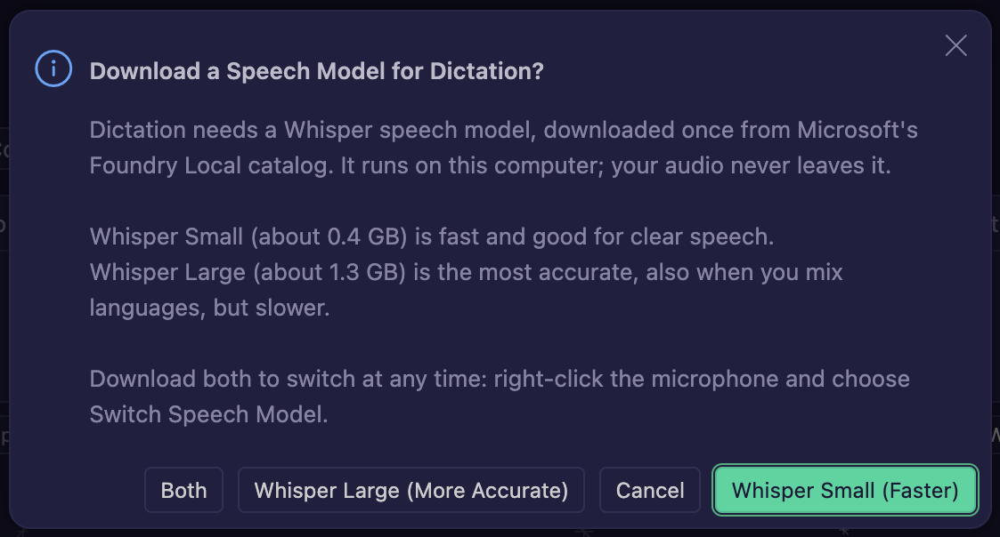
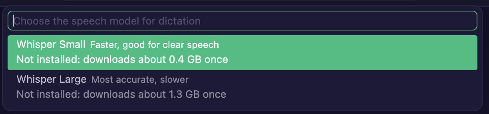

# Dictation

Talk instead of type. Dictation turns what you say into text in the chat input box, in the editor window and in the Agents window. CreaEditor dictates with OpenAI's **Whisper** speech model, which runs on your own computer: your audio never leaves it. You choose between two sizes:

| Model | Size | Speed | Best for |
| --- | --- | --- | --- |
| **Whisper Small** | about 0.4 GB | fast | clear speech, short messages |
| **Whisper Large** (Large v3 Turbo) | about 1.3 GB | slower, a few seconds per sentence | the best accuracy, also when you mix Dutch and English |

You can install both and switch at any time.

## How it works

- **The model runs on this computer.** Whisper runs through Microsoft's Foundry Local runtime, which comes with CreaEditor. The models themselves are not in the app: the one you choose is downloaded once, the first time you dictate, and only after you agree to it.
- **Text appears per sentence.** Whisper listens until you pause, then writes what you said. While it works on a sentence, the words appear in the input box one by one; you can keep talking meanwhile. When you stop dictation, the last sentence is written too.
- **Dutch and English mixed.** Whisper keeps English words in English inside, for example, a Dutch sentence ("Kun je de functie parseConfigFile aanpassen?"). It needs to know which language you speak besides English (see below). Pause briefly when you switch language between sentences: Whisper writes one language per sentence and can skip a whole sentence in the other language when there is no pause between them.

## Using it

### The first time: choose and install a model

1. Click the microphone button in the chat input box (or use the dictation shortcut, **Cmd+I**).
2. CreaEditor asks right away **Download a Speech Model for Dictation?** and offers three choices:
   - **Whisper Small (Faster)**, about 0.4 GB.
   - **Whisper Large (More Accurate)**, about 1.3 GB.
   - **Both**: Small first, so you can start dictating sooner, then Large.

   
3. The download runs in the background, with its progress (and a cancel button) in a notification. Dictation does not start yet. Click **Cancel** in the dialog and nothing is downloaded.
4. When the download is done, CreaEditor says, for example, **Whisper Small is installed. Start dictation again to talk.** Click the microphone again.

### Switch between Small and Large

Right-click the microphone button and choose **Switch Speech Model...** (or run **Switch Dictation Speech Model** from the Command Palette). The list shows both models and which one is installed and in use. Pick an installed model to switch at once; pick one that is not installed yet and CreaEditor asks before it downloads it, then switches when it is done.

The first time you dictate, macOS asks whether CreaEditor may use the microphone. Click **Allow**. Changed your mind? Turn it on again in **System Settings > Privacy & Security > Microphone**.

### Dictate

1. Click the microphone button and talk.
2. A slim **listening bar** shows directly above the input box while dictation listens: a live graph of your microphone level, and **Listening…** or, while Whisper writes a sentence, **Transcribing…**. When your system is set to reduce motion, the graph is a still level meter instead.
3. Click the microphone again to stop. In the editor window's chat, **Escape** cancels and throws away what was said.

### Choose your language

Whisper writes in the language it is told; told nothing, it writes English and translates other languages into English. The setting **Dictation: Language** (`dictation.language`) picks the language:

- **Automatic** (the default) uses the Voice Mode language when you set one, otherwise the first language other than English in the display language and in your system's preferred languages (macOS: **System Settings > General > Language & Region**). With English and Dutch there, it uses Dutch.
- When you mix English with another language, choose the other language, for example **Dutch**. English sentences stay English.
- Choose **English** only when you speak English alone.

## Good to know

- Whisper Large uses the processor for a few seconds per sentence. On a busy computer the text can lag a little behind; it catches up when you pause. Too slow? Switch to Whisper Small.
- The model in use is the setting **Dictation: Model** (`dictation.model`). It also offers Nemotron (on-device, streams word by word, less accurate) and MAI (cloud, needs a GitHub account).
- Remove the models: delete the folder `chatDictationModels` in CreaEditor's cache folder (`~/Library/Application Support/CreaEditor/chatDictationModels` on macOS). CreaEditor asks again before downloading one the next time.
