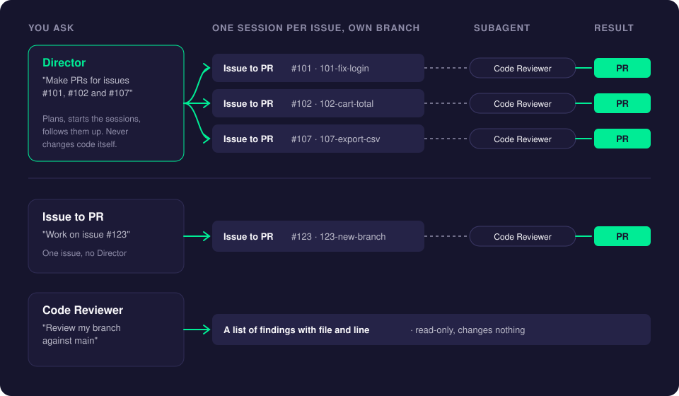
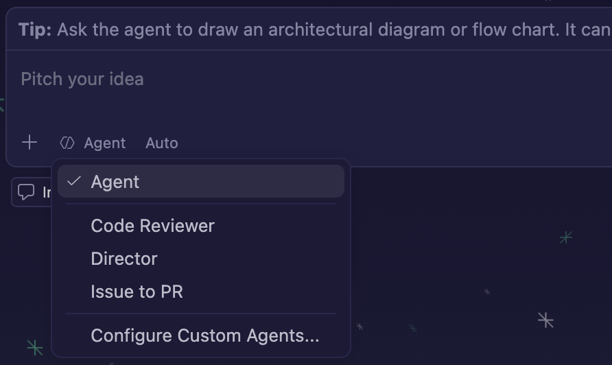

# Director, Issue to PR and Code Reviewer

CreaEditor ships three agents that turn issues into reviewed pull requests. They work together, but you can use each one on its own:

- **Issue to PR** takes **one** issue all the way to a pull request: it reads the issue, writes the code and the tests, has the Code Reviewer check it, fixes what the review finds, and opens the pull request.
- **Director** handles **several** issues at once: it starts one Issue to PR session per issue, each on its own branch, and follows them up.
- **Code Reviewer** only **reviews**: it reads the changes on a branch and reports problems, with file and line. It never changes anything.

## Which one do I use?

| You want to... | Use | Example prompt |
| --- | --- | --- |
| Finish one issue, from reading it to a pull request | **Issue to PR** | `Work on issue #123` |
| Finish several issues at the same time | **Director** | `Make PRs for issues #101, #102 and #107 on develop` |
| Get a second opinion on a branch, without changes | **Code Reviewer** | `Review 101-fix-login against main` |
| Just ask a question or make a quick change | the normal **Agent** | `Why does the cart total round down?` |

When in doubt: one issue means **Issue to PR**, more than one means **Director**.

## Before you start

- **GitHub issues:** install the GitHub CLI and sign in once: run `gh auth login` in a terminal. For GitHub Project boards (moving the issue to In Progress and In Review), also run `gh auth refresh -s project`.
- **Jira issues:** connect Jira once with **CreaEditor: Connect Jira...** (see [Jira](agents-window.md#jira)). The code still goes to GitHub, so `gh` is needed too.
- Open the repository's folder in the Agents window (the folder button above the input box).

## Using it

All three are in the **Agent** picker below the input box in the Agents window.

### Issue to PR: one issue

1. Open the Agents window (**Cmd+Shift+A**) and pick your repository in the folder button.
2. Click **Agent** below the input box and choose **Issue to PR**.
3. Optional but handy: check **New Worktree**, so the work happens in its own copy of the repository and your own files stay untouched.
4. Type which issue, and press Enter:
   - `Work on issue #123` or a GitHub issue link: a **GitHub** issue.
   - `Finish PROJ-45` or a Jira link: a **Jira** issue.
   - Only a number or a title? It asks **"Is this a GitHub issue or a Jira issue?"** first. Answer and it continues.
5. It works through these steps on its own, and you can follow them in the chat:
   1. Reads the issue and its acceptance criteria, and moves it to **In Progress** (on the GitHub Project board or in Jira).
   2. Creates a branch, such as `123-fix-login-redirect`.
   3. Reads the project's own rules (AGENTS.md, CONTRIBUTING, the build files) to learn how to test and what the conventions are.
   4. Plans, writes the code, adds tests and runs the project's checks.
   5. Has the **Code Reviewer** review the changes (you see it as a subagent card in the chat and in the Agents tree), and fixes the real findings. At most two rounds.
   6. Pushes the branch, opens the pull request (with `Closes #123`, or the Jira key in the title) and moves the issue to **In Review**.
6. At the end it reports the pull request link, the test results and anything it could not do.

It never merges or deploys. You review and merge the pull request yourself.

### Director: several issues at once

1. Open the Agents window and pick your repository in the folder button.
2. Click **Agent** and choose **Director**. The New Worktree checkbox disappears: the Director itself never changes code.
3. Describe the work, for example `Make PRs for issues #101, #102 and #107 on develop`, and press Enter. It asks whether they are GitHub or Jira issues when that is not clear.
4. The Director reads the issues, checks that they do not touch the same code and proposes one session per issue. **Confirm the list once.**
5. The sessions appear in the Sessions list under one group name. Each one is an **Issue to PR** session in its own worktree on its own branch, with its own Code Reviewer, exactly as if you had started it yourself. A session that fails does not stop the others.
6. The Director follows them up and ends with a table of the branches and pull request links.

On the [AI Costs](costs-and-budgets.md) page every issue gets its own group with the cost of its session. The Director's own chat is listed under **Not linked to an issue**, so you also see what the coordinating cost.

### Code Reviewer: a review only

1. Click **Agent** and choose **Code Reviewer**.
2. Say which branch to review and against which branch, for example `Review 101-fix-login against main`. Add the issue number to have it check the acceptance criteria too: `Review 101-fix-login against main for issue #101`.
3. It replies with a verdict and a numbered list of findings, each with the file and line, and what it checked without findings.

It is read-only: it never edits files, commits, pushes or changes issues. Without a branch it reviews the current branch against the repository's default branch.

## Tips

- **Keep issues small and clear.** The agents work from the issue's description and acceptance criteria; the clearer they are, the better the pull request.
- **Name the base branch** when it is not the default one: `Work on issue #123 on develop`.
- **Choose the model** in the model picker before you press Enter. Subagents, such as the Code Reviewer, use the same model unless you ask for another one in your prompt.
- **Stop at any time** with the stop button in the chat, or **Stop All Chats** at the top of the Sessions list.

## Make your own version

To change how one of these agents works for a project, copy it into the project's `.github/agents/` folder and edit the copy. Give the copy its own name on the `name:` line at the top (for example `Issue to PR (Shop)`), so you can pick it in the Agent picker next to the built-in one. A copy of the Director must keep a file name ending in `director.agent.md` (for example `sprint-director.agent.md`). To have your Issue to PR copy use your own reviewer, name that reviewer in it instead of **Code Reviewer**.

The built-in agents are in the CreaEditor app: open one from **Customizations > Agents** in the Agents window to read or copy it.

## Related pages

- [The Agents Window](agents-window.md)
- [Costs and Budgets](costs-and-budgets.md)
- [Models and Keys](models-and-keys.md)
