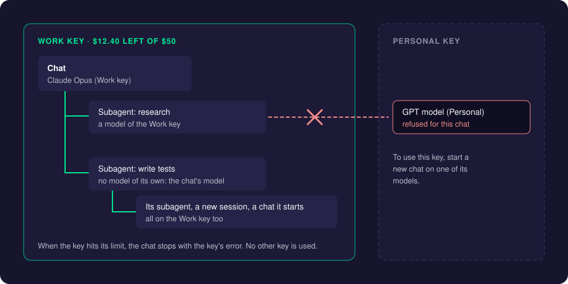
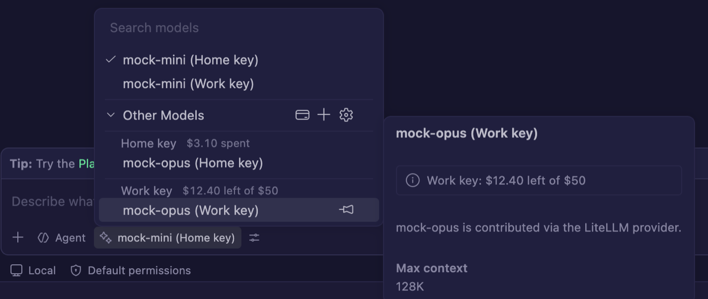

# Models and Keys

CreaEditor needs no GitHub Copilot account. Chat and agents run on models you bring yourself: an API key for a provider such as Anthropic or OpenAI, a key for a gateway such as OpenRouter or LiteLLM, or a Claude or Codex subscription. Signing in to GitHub (for pull requests, for example) never adds Copilot models.

This page explains how to add models, how to use several keys side by side, and how CreaEditor keeps every chat on the key it started on.

## How it works

A **gateway** is a service between CreaEditor and the model providers. **OpenRouter** is a public one; **LiteLLM** is a proxy your company can run itself. You give CreaEditor a key for the gateway, and it lists the models that key may use.

You can connect several keys, for example a work key and a personal key, each with its own spending limit. Every model then carries the name of its key ("Claude Opus (Work key)"), and a chat stays on the key it started on: the chat, all its subagents and everything it starts use that one key, and nothing else.

## Using it

### Add OpenRouter or LiteLLM

1. Open the Command Palette (**Cmd+Shift+P**) and run **Add OpenRouter or LiteLLM Models...**. You can also click **Add OpenRouter / LiteLLM...** (or **+** next to **Other Models**) in the model picker below the chat input.
2. Press Enter to keep the OpenRouter address (`https://openrouter.ai/api/v1`), or paste the address of your LiteLLM proxy. CreaEditor detects which of the two it is. If the proxy is only reachable over Tailscale or a VPN, connect that first.
3. Type a name for the key, such as "Work key".
4. Paste the API key (an OpenRouter key, or a LiteLLM virtual key). It is stored in your Mac's secret storage, never in a settings file.

What you get:

- **OpenRouter:** the presets of your account appear in the model picker automatically. Running the command again lets you add more models; it only offers the models your key's guardrails, provider preferences and privacy settings allow, so the picker stays short.
- **LiteLLM:** every model your virtual key may use appears automatically, with its context size, tool calling and image support taken from the proxy.

### Add another key

1. Run **Add OpenRouter or LiteLLM Models...** again.
2. Choose **Connect OpenRouter or a LiteLLM Proxy...**.
3. Give the new key its own name and paste it.

Each key has its own name, presets, guardrails and models. The model picker shows each model once, under the name of its key.

### Other providers and extensions

- **Chat: Manage Language Models** (or **Manage Models...** in the model picker) adds a key for Anthropic, OpenAI, Azure, Gemini, Ollama, a custom OpenAI-compatible endpoint and others.
- The **Claude Code** and **Codex** extensions install from the Extensions view and work as in VS Code.
- To use a Claude or Codex **subscription** (rather than an API key), see [Subscription Accounts](subscription-accounts.md).

### See what each key has left

With several keys, the model picker shows what is left of each key next to its name, for example "Work key · $12.40 left of $50", or "$3.10 spent this month" for a key without a limit. Point at a model to see the same in its hover. CreaEditor reads the limit every 5 minutes while the window has focus, and shortly after requests.

Once a key shows its limit, the credit card button next to **Other Models** opens the [AI Costs](costs-and-budgets.md) page.

## The key lock

A chat stays on the key it started on. In practice:

- **There is no separate "default key":** a new chat uses the key of the model you pick in the model picker. To work on another key, pick one of its models before you send the first message.
- **Subagents use the same key.** So do their own subagents, and the sessions and chats the chat starts (for example the sessions of a [chat group](agents-window.md#chat-groups-several-pull-requests-at-once)). This holds in the editor chat and in the Agents window.
- **Another key's model is refused.** A subagent that asks for a model only another key offers ends with "The model ... is not available to this chat: subagents stay on the key ... the chat uses." on its card. The parent chat keeps going.
- **An agent file can name a model without its key** (`model: Programmer Agent (preset)`). The model of the chat's own key is used. When the chat's key does not offer that model at all, the agent runs on the chat's own model.
- **Switching an Agents window chat to a model of another key is refused.** Start a new chat for that.
- **No fallback.** When a key reaches its limit, the request fails with the error of that key. CreaEditor never quietly moves to another key, so spending stays where you expect it.

## Request metadata

You can send extra HTTP headers or body fields with every request of a key, for example your team or project name for the gateway's logs. Set them per key, per model, or on a single model entry, with variables such as `${sessionId}`, `${workspaceFolderName}` and `${env:NAME}`.

1. Run **Chat: Open Language Models (JSON)**.
2. Add a `requestMetadata` block to the key's entry, with `headers` and `body`.

The prompt fields themselves (`messages`, `tools`, `model` and similar) can never be overridden. CREAEDITOR.md in the repository lists every variable and the exact precedence.

CreaEditor also labels every OpenRouter and LiteLLM request with its chat, issue and repository on its own, so costs can be split per issue; see [Costs and Budgets](costs-and-budgets.md).

## Settings

| Setting | Default | What it does |
| --- | --- | --- |
| `chat.utilityModel` | (the chat's model) | The model for helper tasks such as chat titles and summaries. |
| `chat.utilitySmallModel` | (the chat's model) | The small model for quick helper tasks. |
| `chat.subagents.allowInvocationsFromSubagents` | `true` | Lets subagents start their own subagents. |
| `chat.subagents.maxNestingDepth` | `5` | How many levels deep subagents may go (at most 10). |

Gateway options live in `chatLanguageModels.json` (**Chat: Open Language Models (JSON)**), not in settings: `"showAllModels": true` lists the whole OpenRouter catalog, and `"hiddenModels": [...]` hides LiteLLM models.

## Good to know

- The built-in search and execution subagents of the editor chat cannot pick a model per key, so on a key they always use the chat's own model.
- The [AI Costs](costs-and-budgets.md) page records which key each request used.
- When you delegate a Copilot CLI chat on a gateway model to a [CreaEditor Server](delegate-to-server.md), its key goes along, encrypted, and the lock applies there too.

## Troubleshooting

- **A model is missing from the picker.** OpenRouter only lists models your key's guardrails allow. Change the guardrails on openrouter.ai, or run **Add OpenRouter or LiteLLM Models...** again to add the model.
- **"The model ... is not available to this chat".** The chat runs on another key than that model. Start a new chat on the model you want.
- **A chat stops with a limit error.** The key reached its spending limit. Raise the limit at the gateway, or start a new chat on another key.

## Related pages

- [Costs and Budgets](costs-and-budgets.md)
- [Subscription Accounts](subscription-accounts.md)
- [The Agents Window](agents-window.md)
