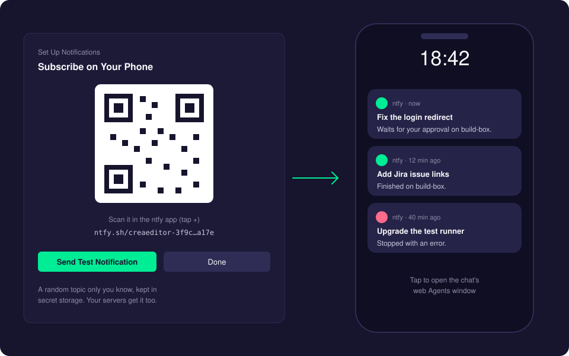
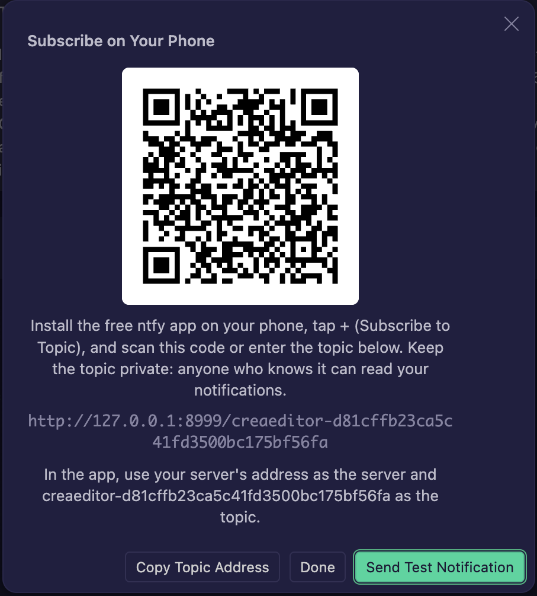

# Notifications

Get a push notification on your phone when a chat finishes, stops with an error, or waits for your approval or an answer. It works for chats on this computer (handy with [Remote Access](remote-access.md)) and on your [CreaEditor Servers](creaeditor-server.md), also while your laptop is off.

It uses [ntfy](https://ntfy.sh): a free app for iOS and Android. No account is needed.

## How it works

- ntfy works with **topics**: a topic is an address such as `https://ntfy.sh/creaeditor-…`. Whoever subscribes to a topic gets the messages sent to it.
- CreaEditor makes a topic with a random 128-bit name that only you know, and shows it as a QR code. Your phone subscribes to it in the ntfy app.
- The agent host of this computer, and of every CreaEditor Server this computer connects to, sends a short message to that topic when a chat changes status. A server keeps the topic in its encrypted store, so it can notify you after a restart while your laptop is off.
- **Only when you are away:** by default you only get a notification when no CreaEditor window on a computer had focus for 5 minutes. At your desk, nothing buzzes.

## Using it

### Set it up

1. Install the free **ntfy** app on your phone.
2. In CreaEditor, open the Command Palette (**Cmd+Shift+P**) and run **Set Up Notifications** (or click the button on the CreaEditor Features page).
3. Choose **Use ntfy.sh (Recommended)**. CreaEditor makes the topic and shows a QR code.
4. In the ntfy app, tap **+** (Subscribe to Topic) and scan the QR code, or type the topic.
5. Back in CreaEditor, click **Send Test Notification**. It shows on your phone within a few seconds.

Run **Set Up Notifications** again at any time to show the QR code, send a test, use a new topic, or turn notifications off.

### Use your own ntfy server

Choose **Use My Own ntfy Server...** instead of ntfy.sh, enter the server's address and, for a server with access control, an access token (`tk_...`) that may publish to the topic. In the app, use your server's address as the server.

### What a notification says

A notification has the chat's title and a short message, such as "Finished on build-box." or "Waits for your approval or answer.". It never contains code or other content. Tapping it opens the web Agents window (the Remote Access address of your Mac, or the server's address).

What triggers one:

| Event | When |
| --- | --- |
| `finished` | A chat is done. |
| `failed` | A chat stopped with an error. |
| `needsInput` | A chat waits for your approval or an answer. |

A status must hold for a few seconds (an approval you answer right away does not notify), every change notifies once, and at most 10 notifications go out per minute. An automatic [compaction](subscription-accounts.md#compacting-idle-claude-chats-before-the-prompt-cache-expires) never notifies.

## Settings

| Setting | Default | What it does |
| --- | --- | --- |
| `creaeditor.notifications.enabled` | `false` | Send push notifications. **Set Up Notifications** turns it on. |
| `creaeditor.notifications.events` | `["finished", "failed", "needsInput"]` | Which events send a notification. |
| `creaeditor.notifications.onlyWhenAway` | `true` | Only notify when no CreaEditor window on a computer had focus for the away time. |
| `creaeditor.notifications.awayMinutes` | `5` | How many minutes without a focused CreaEditor window count as away. |

These settings apply to every agent host this computer connects to, servers included.

## Privacy

- **Keep the topic private.** Anyone who knows a topic can read its messages. The topic name is random and long, so nobody can guess it, but do not share the QR code.
- The topic (and the access token of your own server) is kept in CreaEditor's secret storage, never in settings.
- Messages hold only the chat's title and its status, not code or conversation text.
- When you turn notifications off, your servers forget the topic the next time this computer connects to them.

## Troubleshooting

- **The test notification does not arrive.** Check that you subscribed to exactly that topic in the app, and that the phone allows notifications for ntfy.
- **No notifications while working.** That is the default: you are not "away". Turn off `creaeditor.notifications.onlyWhenAway`, or lower `creaeditor.notifications.awayMinutes`.
- **"The ntfy server refused the notification".** Your own server needs an access token that may publish to the topic.
- **"Your phone needs to subscribe again."** You chose a new topic. Scan the new QR code in the app.

## Related pages

- [Remote Access](remote-access.md)
- [CreaEditor Server](creaeditor-server.md)
- [Delegate to Server](delegate-to-server.md)
