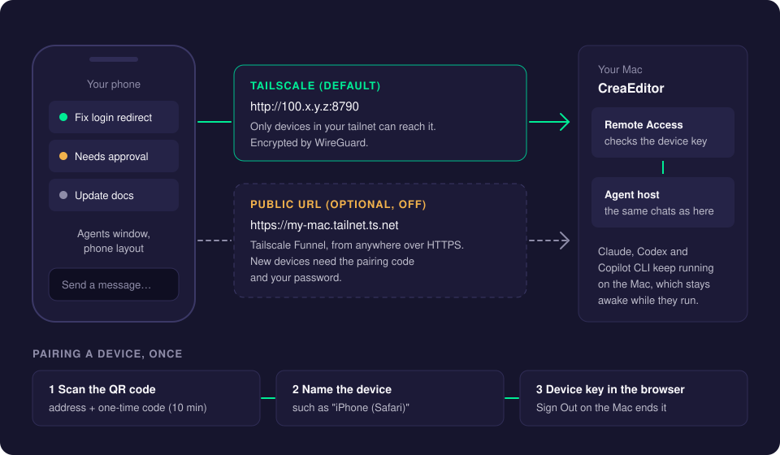
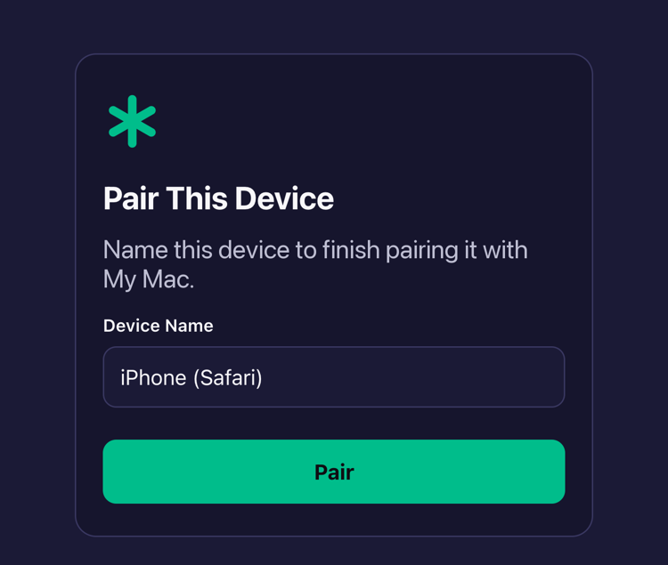
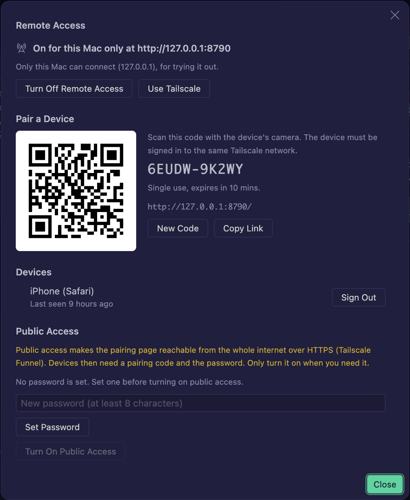
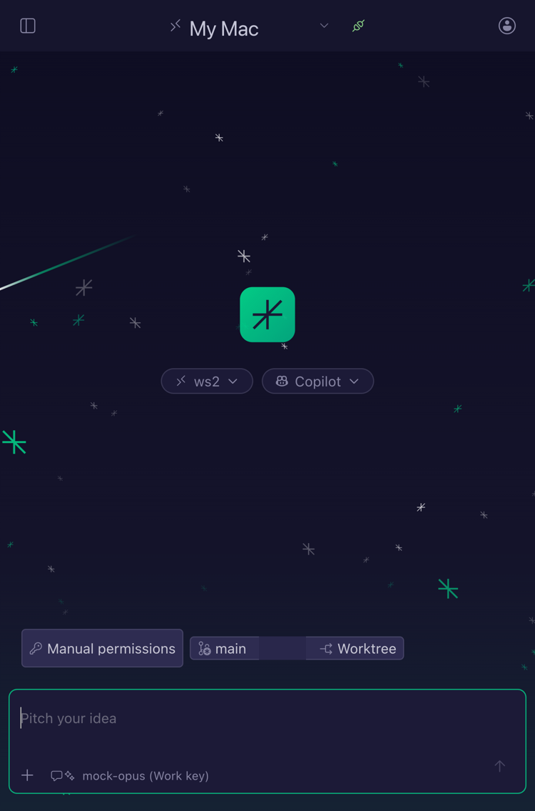
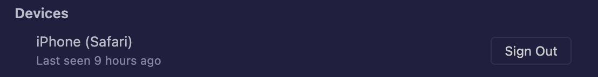

# Remote Access

Remote Access lets you use the Agents window of your Mac from your phone or another computer. Follow your chats live, send messages, approve tools and stop chats, while the agents keep running on the Mac. Go for coffee; your agents keep going, and you can still answer them.

## How it works

- CreaEditor runs a small web server on your Mac. It serves the Agents window as a web page (with a layout made for phones) and connects the page to the same agents as every CreaEditor window.
- **Tailscale** is the default way in. Tailscale is a free app that puts your devices in one private network (a "tailnet"), wherever they are. Remote Access listens only on the Mac's Tailscale address, never on all networks, so only your own devices can reach it. Traffic inside a tailnet is encrypted, so a plain `http://` address is fine there.
- A **public URL** is optional and off by default. It uses Tailscale Funnel to make the page reachable from the whole internet over HTTPS, for example from a phone without Tailscale. New devices then need a password as well as the pairing code.
- **Pairing:** a device connects once with a QR code that holds the address and a one-time pairing code. It then gets its own **device key**, a long random secret kept in that device's browser. You can sign out any device at any time.
- **Keep-awake:** while Remote Access is on and a chat runs, the Mac does not go to sleep.

## Using it

### Set up Tailscale (once)

1. Install [Tailscale](https://tailscale.com/download) on the Mac and on your phone.
2. Sign in to the same account on both.

### Turn it on and pair your phone

1. In the Agents window, click the phone button at the top right, or run **Show Remote Access** from the Command Palette.
2. Click **Allow Remote Access**. The dialog shows the address (such as `http://100.x.y.z:8790`, and the MagicDNS name when your tailnet has one) and a QR code.
3. Scan the QR code with your phone's camera and open the link.
4. The **Pair This Device** page asks for a device name. It suggests one, such as "iPhone (Safari)". Keep it or type another, and tap **Pair**.

   

5. The Agents window opens in the phone layout. Tip: add it to your home screen for an app-like window.

Pairing codes work once and expire after 10 minutes; **New Code** makes another. The device remembers its key, so next time it only needs the address.

**Allow Remote Access** is also a command: run it again to turn Remote Access off. Paired devices can no longer connect until you turn it on again.

### What you can do from the phone

- See all sessions and chats live, the same as in every window.
- Open a chat and follow its output as it is written.
- Send messages, and pick the agent and the model.
- Approve or skip tool calls.
- Stop a chat, or **Stop All Chats**.

Anything you start runs on the Mac. The phone is only a window onto it.

### Manage devices

The **Devices** list in the dialog shows every paired device with when it was last seen. **Sign Out** ends that device's key and closes its connections at once.

### Public access (optional)

1. In the dialog, set a password (at least 8 characters) with **Set Password**.
2. Click **Turn On Public Access**. CreaEditor turns on Tailscale Funnel for the port and shows the public `https://` address (such as `https://my-mac.tailnet.ts.net`). The QR code now holds that address.
3. Pair as before. While public access is on, every new pairing needs the password as well as the pairing code.

**Turn Off Public Access** (or turning Remote Access off) turns Funnel off again. Funnel must be allowed for your tailnet once; if it is not, the dialog shows Tailscale's link to allow it.

### Try it on the Mac (no Tailscale needed)

1. Click **Use Localhost Only** in the dialog (or set `creaeditor.remoteAccess.network` to `localhost`).
2. Turn Remote Access on and click **Copy Link**.
3. Open the link in a browser on the Mac. The browser's device toolbar (a phone size such as 390×844) shows the phone layout.

## Settings

| Setting | Default | What it does |
| --- | --- | --- |
| `creaeditor.remoteAccess.enabled` | `false` | Turns Remote Access on. |
| `creaeditor.remoteAccess.network` | `tailscale` | Where it listens: `tailscale` (the Mac's Tailscale address) or `localhost` (127.0.0.1 only, for trying it out). |
| `creaeditor.remoteAccess.port` | `8790` | The port it listens on. |

These settings are per machine and do not sync to your other computers.

## Security

- **Device keys** are long random secrets. The Mac stores only a fingerprint (hash) of each key, not the key itself. The password is stored as a hash too.
- **Lockout:** five wrong pairing codes or passwords from one address within 15 minutes lock that address out for 15 minutes. 30 failures from all addresses together lock pairing for everyone for 15 minutes.
- **No data without a key.** The pages and scripts of the web Agents window load without a key (they are the same for everyone and hold no data). Everything with data needs a device key.
- **Devices paired over Tailscale keep working** when you turn public access on. Sign them out if you want everyone to need the password.
- **A paired device can do what you can do** in the Agents window, including running commands on the Mac through the agents. Sign out devices you lose.

## Good to know

- **Closing the lid** still puts most MacBooks to sleep, unless they are on power with an external display. Keep-awake only stops the Mac from sleeping on its own.
- Quitting CreaEditor leaves Funnel configured; the public address then answers with an error until CreaEditor runs again.
- Want the agents to keep running with the laptop closed? Use a [CreaEditor Server](creaeditor-server.md) and [Delegate to Server](delegate-to-server.md).
- Instead of Funnel, you can put a Cloudflare Tunnel in front of the port (network set to `localhost`). Then protect it with Cloudflare Access, because CreaEditor only asks for the password when its own public access is on.

## Troubleshooting

- **The phone cannot open the address.** Check that Tailscale is on and signed in to the same account on both devices, and that the dialog says "On via Tailscale".
- **"This code expired."** Click **New Code** and scan again.
- **Locked out after typing a wrong code.** Wait 15 minutes, then try again with a new code.
- **The page shows only the pairing form.** This build has no web Agents window. Install the CreaEditor build from the team's .dmg.
- **Public access does not turn on.** Funnel is not allowed for your tailnet yet. Follow the link in the dialog, allow it once, and try again.

## Related pages

- [Notifications](notifications.md)
- [CreaEditor Server](creaeditor-server.md)
- [The Agents Window](agents-window.md)
