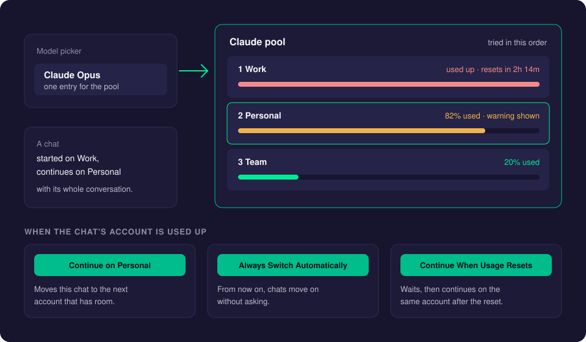
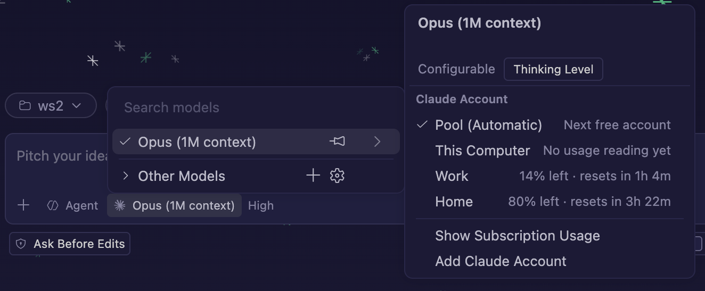
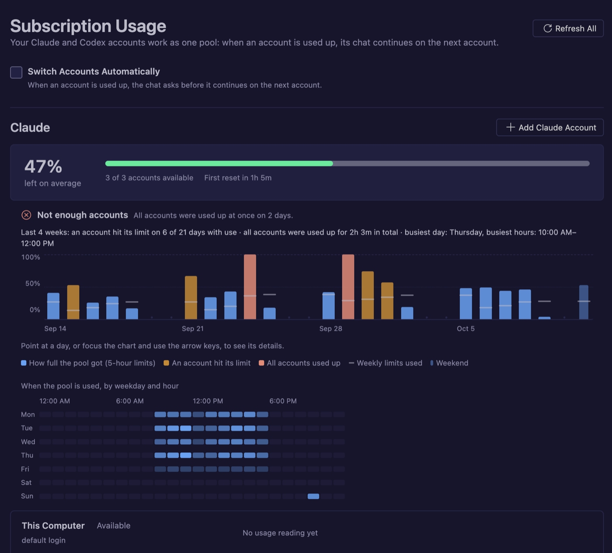
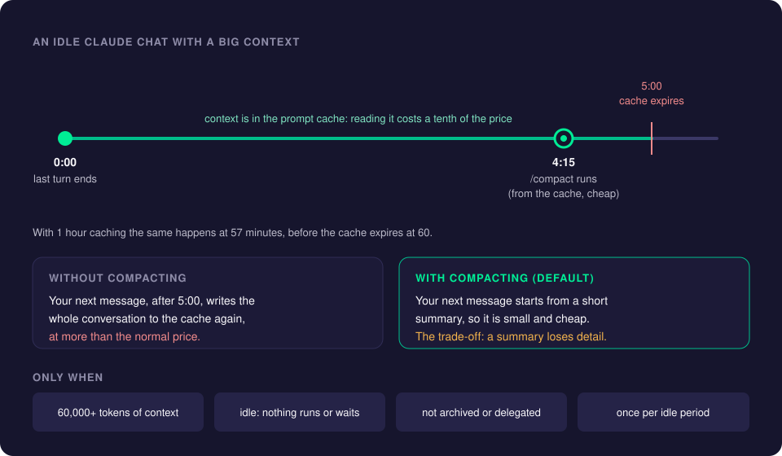
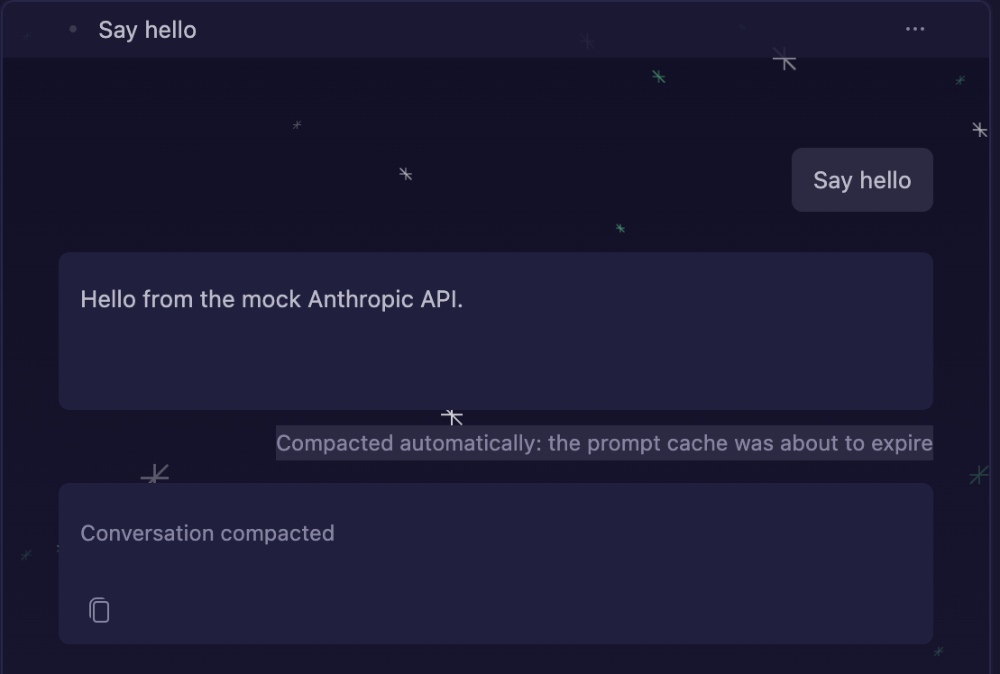

# Subscription Accounts

A Claude or ChatGPT subscription has usage limits, for example a 5-hour window and a weekly window. With several subscriptions (a work and a personal plan, or five work accounts), CreaEditor pools them: the model picker keeps a single Claude and a single Codex entry, new work goes to the first account that has room, and a chat whose account is used up can continue on the next one, with its whole conversation.

There is no limit on how many accounts you add.

## How it works

- The accounts of a provider form one **pool**. They are tried in the order you set in **Manage Subscription Accounts**.
- A new chat starts on the first account with room. It stays there until that account is used up.
- When the account is used up, the chat asks what to do (or switches by itself, if you chose that), and continues on the next account **with the full chat carried over**: the whole conversation, tool results and images. Claude resumes the same session and Codex the same thread on the other account.
- The login you already had on this Mac (`~/.claude`, `~/.codex`) is always in the list, first. For Claude it is called **This Computer**.

## Using it

### Add an account

Run one of these from the Command Palette (category Chat):

| Command | What it does |
| --- | --- |
| **Add Claude Account** | Asks a name, then **Paste a Setup-Token** or **Sign In with the Browser**. |
| **Add Codex Account** | Asks a name and opens the ChatGPT sign-in page. |
| **Manage Subscription Accounts** | Lists the accounts per provider: sign in, refresh usage, rename, move up or down (the order in which they are tried), remove. |
| **Show Subscription Usage** | Opens the usage page. |

To add a Claude account with a setup-token:

1. Open a terminal and run `claude setup-token`. Follow the steps; it prints a long token.
2. In CreaEditor, run **Add Claude Account** and type a name, such as "Work".
3. Choose **Paste a Setup-Token** and paste it. It is kept in the macOS keychain.

With **Sign In with the Browser**, the Claude CLI opens claude.ai for you. If that fails, CreaEditor offers to run the printed `claude auth login` command in a terminal.

> After installing a new CreaEditor build, macOS asks once for access to **CreaEditor Safe Storage** (where the tokens are kept). Choose **Always Allow**.

### Choose the account of a chat

With two or more accounts, choosing a Claude or Codex model in the model picker opens a list with **Pool (Automatic)** and every account, with what each has left. Used-up and signed-out accounts are greyed out.

1. Click the model button below the chat input.
2. Point at the Claude (or Codex) model and pick an account, or **Pool (Automatic)**.

Picking an account pins the chat to it; the model button then shows, for example, "Claude Opus 5.5 · Work". When that account is used up, the chat runs on the pool (or asks, as usual) and goes back to the pinned account once it has room again. Pins last while CreaEditor runs. Below the accounts, **Show Subscription Usage** and **Add Claude Account** / **Add Codex Account** lead to the accounts without changing the model.

### Before an account is used up

When an account's tightest window passes 80% (and again at 95%), a notification says so, once per window and reset, for example "The Claude account Work has used 82% of its 5-hour limit (resets in 1h 12m)." It has **Show Usage** and **Don't Warn Again**. A chat running on that account gets a short note too, and from then on the account's usage is read every two minutes instead of every ten.

### When an account is used up

The chat shows the limit with these choices:

- **Continue on** *next account*: moves this chat to the next account that has room.
- **Always Switch Automatically**: turns on `chat.subscriptionAccounts.autoSwitch`, so from now on chats move on without asking (like "allow all", but for limits).
- **Continue When Usage Resets**: the chat waits ("Waiting for the Work account's 5-hour limit to reset at 14:05…") and continues the interrupted turn on the same account a minute after the reset, once a new reading confirms it. **Stop** cancels the wait. This works for Claude and Codex, also when no other account is left. The wait runs in the window, so keep CreaEditor open.

When every account is used up, the chat says when the first one resets and offers **Add Claude Account** / **Add Codex Account** and **Show Usage**.

How the turn continues: a turn that had not started yet is sent again exactly as it was, with its attachments. Otherwise the model is asked to continue ("Continue where you left off." for Claude, which shows as an extra turn when you look back at the chat).

### The usage page

Open it with **Show Subscription Usage**, the pulse button next to AI Costs at the top of the Sessions list in the Agents window, the status bar item in the editor window, or **Show Usage** on a warning.

- Per provider, a card shows the pool's average share left, how many accounts are available and the first reset.
- One row per account shows its email, plan, status and a bar per usage window ("38% left · resets in 3h").
- **Usage history:** below the pool and every account, a chart shows the used share per window over the past four weeks (point at it for the values of an hour), with a summary such as "Hit its limit 6 times in 4 weeks", and whether all accounts were ever used up at once. Use it to judge whether the pool has enough accounts.

In the editor window, the status bar shows the short version, such as **Claude 62% · Codex 80%**. Its hover lists every account; a click opens the page.

## Compacting idle Claude chats before the prompt cache expires

This saves money on big Claude chats that you leave alone for a while. It is on by default.

### Why

Anthropic keeps the context of a Claude chat (everything said so far) in a **prompt cache**: a short-term memory on Anthropic's side, so the next request does not have to send it all again at full price. Reading the context from the cache costs a tenth of the normal price. But the cache only lives a short time after each request, chosen per request: **5 minutes** by default, **1 hour** when the request uses Anthropic's 1-hour caching.

When you send a message after the cache expired, the whole context is written to the cache again, at more than the normal price. For a big chat that you come back to after lunch, that adds up.

### What CreaEditor does

Shortly before the cache expires, CreaEditor compacts the idle chat: it runs the Claude CLI's own `/compact`, which replaces the conversation with a short summary.

- **When:** 4 minutes 15 seconds after the chat's last turn ended, before the 5-minute cache expires; 57 minutes when the chat uses Anthropic's 1-hour cache, before it expires at 60 minutes. CreaEditor sees which cache the last request used from the turn's usage.
- **Cheap:** the summary is made from the cached context, which is read at the low cache price.
- **The result:** your next message starts from the small summary instead of the whole conversation.

The chat shows it as **Compacted to save cost: the prompt cache was about to expire, so the conversation was summarized while reading it was still cheap.**, followed by "Conversation compacted: older messages were summarized." After a reload the chat still shows why it was compacted: CreaEditor remembers its automatic compactions in the chat's data. A `/compact` you send yourself only shows "Conversation compacted: older messages were summarized." It does not send a phone notification and does not mark the chat as unread.

### When it happens

All of this must hold:

1. The setting `creaeditor.claude.compactBeforeCacheExpires` is on (the default).
2. The context of the last request (input, cache read and cache write tokens) is at least `creaeditor.claude.compactBeforeCacheExpiresMinTokens` (default 60,000). Smaller chats are cheap to send again and keep all their detail.
3. The chat is idle: no running turn, no queued or steering message, nothing waiting for your approval or answer. A chat waiting for a usage reset ended with an error and is never compacted.
4. The chat is not archived, read-only or delegated to a server. (A delegated chat is archived on the laptop; on the server, it is compacted there.)
5. It was not compacted since your last message. A `/compact` you sent yourself counts.

A new message cancels a planned compaction, and a chat is compacted at most once per idle period. On a [CreaEditor Server](creaeditor-server.md) at its running chats limit, the compaction is skipped rather than queued.

### The trade-off

A summary loses detail of the conversation: exact file contents, tool output, earlier wording. The agent can read files again, but it no longer "remembers" everything word for word. If that matters for a chat, turn the feature off, or raise the threshold so only big chats are compacted.

## Settings

| Setting | Default | What it does |
| --- | --- | --- |
| `chat.subscriptionAccounts.autoSwitch` | `false` | When an account is used up, continue on the next account without asking. |
| `chat.subscriptionAccounts.usageWarningThreshold` | `80` | Warn when an account has used this share (in percent) of its tightest limit, and again at 95%. `0` turns warnings off. |
| `chat.subscriptionAccounts.whenNoAccountLeft` | `ask` | What a chat does when no other account is left: `ask` (show the limit, offer **Continue When Usage Resets**) or `waitForReset` (wait and continue by itself). |
| `creaeditor.claude.compactBeforeCacheExpires` | `true` | Compact an idle Claude chat shortly before its prompt cache expires. |
| `creaeditor.claude.compactBeforeCacheExpiresMinTokens` | `60000` | The smallest context (in tokens) that is compacted. |

The two compaction settings apply to every agent host this computer connects to, so a CreaEditor Server follows your laptop's choice.

## Good to know

- **The setup-token check is cheap.** A setup-token is checked with one tiny real request (Haiku, one turn) only when it is added or replaced, and again when Anthropic refuses it during a chat. An accepted token is remembered by a fingerprint (never the token itself), so starting CreaEditor does not check it again. Each check uses a very small amount of that account's usage.
- **No usage reading yet.** A setup-token can only send prompts, so its usage is known only after a check or a chat. Until then the account shows "No usage reading yet".
- **Codex accounts run side by side.** Each Codex account that has chats runs its own background process, so chats on different Codex accounts run at the same time, and switching never ends another chat.
- **History and settings are shared.** Each added account has its own login folder, but chat history, settings, skills and agents are shared with `~/.claude` and `~/.codex`, which is what lets a chat move between accounts.
- **Some ChatGPT plans have no Codex usage.** OpenAI then answers "402 Payment Required" and the account shows that note.
- **A chat that cannot move.** When a Codex thread cannot be resumed on the other account, the chat continues on a new thread with the request sent again as text, and says so. A Claude session that cannot be resumed ends the turn with a note saying why.

## Troubleshooting

- **macOS keeps asking about "CreaEditor Safe Storage".** Choose **Always Allow**. Without an Apple Developer ID the answer does not carry over to the next build, so it asks once after each update.
- **A Claude account shows an error after adding it.** The setup-token was refused. Run `claude setup-token` again and replace it in **Manage Subscription Accounts**.
- **Browser sign-in does not open.** Use the `claude auth login` command CreaEditor offers, in a terminal.

## Related pages

- [Models and Keys](models-and-keys.md)
- [Costs and Budgets](costs-and-budgets.md)
- [Delegate to Server](delegate-to-server.md)
